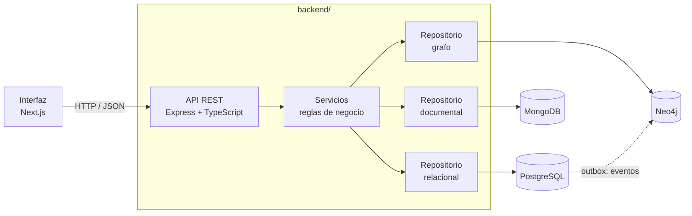

# QATO'K

**Simulaciones de situaciones laborales para practicar habilidades profesionales antes de vivirlas.**

[](https://github.com/The-Tito/qatok-backend/actions/workflows/ci.yml)

Proyecto final de **Bases de Datos en la Nube**, Universidad Politécnica de Chiapas. Es una sola aplicación que usa, de forma coordinada y justificada, una base de datos **relacional** (PostgreSQL), una **documental** (MongoDB) y una **de grafos** (Neo4j).

> **Estado:** la aplicación integrada está disponible en `develop`. El backend sirve los flujos de cuentas, catálogo y administración, juego, perfil, evidencia y compartición. Consulta el [estado de la entrega](#estado-del-proyecto).

---

## Repositorios

QATO'K se divide en dos repositorios:

| Repo | Contenido |
|---|---|
| [**qatok-backend**](https://github.com/The-Tito/qatok-backend) (este) | API REST, esquemas compartidos (`shared/`), scripts de las 3 bases (`database/`), pruebas y documentación evaluable |
| [**qatok-frontend**](https://github.com/The-Tito/qatok-frontend) | Interfaz Next.js; consume solo la API |

`shared/` es la fuente única del contrato; el frontend guarda una copia sincronizada. El historial anterior está en el repo archivado `lsprz2773/BDLN-U3`.

## El problema y la solución

Muchos estudiantes por egresar no tienen experiencia laboral formal: no saben si lo que aprendieron sirve en situaciones reales, les cuesta demostrar sus habilidades y nunca han tomado decisiones con consecuencias.

QATO'K les propone **simulaciones cortas** (un correo de un cliente molesto, una reunión con la jefa, tres entregas para el mismo día). En cada paso el estudiante elige qué hacer, ve las **consecuencias**, recibe **retroalimentación** y la plataforma sigue el **progreso de sus habilidades**. Al terminar puede generar **evidencias** y compartirlas con un enlace que vence o se puede revocar.

## Arquitectura



Cada dato tiene **una sola base dueña** ([matriz de propiedad](docs/modelos/matriz-propiedad.md)):

| Base | Responsabilidad | Por qué este modelo |
|---|---|---|
| **PostgreSQL** | Cuentas, catálogo, estado de simulaciones, intentos y respuestas, evidencias y enlaces compartidos | Transacciones e integridad: registrar una respuesta, cerrar el intento y emitir su evento ocurren juntos o no ocurren |
| **MongoDB** | Contenido de cada simulación y de cada evidencia | Cada simulación es un árbol anidado (pasos → opciones → consecuencias) y cada tipo de paso tiene un contexto con forma distinta |
| **Neo4j** | Recorridos: recomendaciones, fortalezas, decisiones tomadas, evidencias por habilidad, evolución | Consultas de varios saltos sobre conexiones; es dueño del progreso, que es derivado |

Los cambios que el grafo necesita nacen en PostgreSQL junto con un evento (**outbox**), se aplican en Neo4j de inmediato y, si Neo4j no está disponible, se reintentan; un proceso de **reconciliación** detecta y repara diferencias. La API nunca afirma que algo está sincronizado si no lo está.

## Stack

| Capa | Tecnología |
|---|---|
| Interfaz | Next.js (solo consume la API) |
| API | Node.js, TypeScript, Express 5, zod |
| Bases | PostgreSQL 16, MongoDB 7, Neo4j 5 Community (drivers oficiales `pg`, `mongodb`, `neo4j-driver`) |
| Contrato compartido | `@qatok/shared` (esquemas zod que usan backend y frontend; el frontend tiene una copia sincronizada) |
| Pruebas | Vitest y Supertest |
| Infraestructura | Docker Compose y GitHub Actions |

## Requisitos

- **Node.js 22 o superior** (recomendado 24, ver `.nvmrc`)
- **Docker Desktop** (o Docker Engine con Compose v2), encendido
- **Python 3** (validadores del dataset y del modelo)
- Git

## Inicio rápido

```bash
git clone git@github.com:The-Tito/qatok-backend.git
cd qatok-backend
git checkout develop

npm ci
npm run setup:env
npm run db:up
```

Consulta [`.env.example`](.env.example) para ver los nombres y valores de ejemplo. `npm run setup:env` crea las credenciales para el entorno local.

En una instalación local nueva, crea los esquemas y carga los datos de demostración antes de arrancar la API. Los comandos de carga reemplazan datos, así que usa volúmenes de desarrollo vacíos para este paso. El hash habilita el inicio de sesión de las cuentas de prueba con la contraseña del dataset.

```bash
demo_hash=$(node -p \
  'require("bcrypt").hashSync(require("./database/seed/dataset.json")._meta.contrasena_demo, 10)')
QATOK_SEED_PASSWORD_HASH="$demo_hash" npm run db:relational:reset
npm run db:document:reset
npm run db:graph:reset
npm run dev:api
```

Para retomar un entorno ya inicializado, ejecuta `npm run db:up` y `npm run dev:api`. Si necesitas aplicar la [migración de reintentos](database/README.md#cola-de-sincronización) de PostgreSQL, ejecútala antes de arrancar la API.

Desde otra terminal, comprueba la conexión con los tres motores.

```bash
curl http://localhost:4000/api/health
```

```json
{
  "estado": "OK",
  "version": "0.1.0",
  "bases": {
    "relacional": { "ok": true, "latencia_ms": 1 },
    "documental": { "ok": true, "latencia_ms": 1 },
    "grafo": { "ok": true, "latencia_ms": 4 }
  }
}
```

Si una base no responde, el estado es `DEGRADADO`, la respuesta es `503` y esa base aparece con `ok: false`.

Para ejecutar la interfaz, mantén la API en marcha y sigue la instalación del frontend en una carpeta hermana. Abre `http://localhost:3000/login` para entrar con una cuenta del dataset o `http://localhost:3000/status` para consultar la salud de los tres motores. [Inicio rápido del frontend](https://github.com/The-Tito/qatok-frontend/blob/develop/README.md#preparar-tu-máquina)

Comprueba que la carga también permite iniciar sesión con una cuenta de prueba. El comando imprime solo el código HTTP esperado, `200`.

```bash
curl -sS -o /dev/null -w '%{http_code}\n' \
  -H 'Content-Type: application/json' \
  -d '{"email":"ana.lopez@ejemplo.com","password":"Qatok2026!"}' \
  http://localhost:4000/api/auth/login
```

## Comandos

| Comando | Qué hace |
|---|---|
| `npm run setup:env` | Crea `.env` a partir de `.env.example` con secretos aleatorios (no sobrescribe uno existente) |
| `npm run db:up` | Levanta PostgreSQL, MongoDB y Neo4j y espera a que estén sanas |
| `npm run db:down` | Detiene las bases (los datos se conservan) |
| `npm run db:reset` | Detiene las bases **y borra sus datos** |
| `npm run db:relational:reset` | Reconstruye las tablas PostgreSQL de desarrollo desde el dataset. Reemplaza los datos de esas tablas |
| `npm run db:sync:pendiente -- crear` | Deja un evento pendiente en la cola de Ana para ver el aviso «Actualizando tu progreso…» (`quitar` lo elimina). Solo PostgreSQL local |
| `npm run db:relational:migrar` | Aplica las migraciones (reintentos y `habilidad.tipo_visual`) a PostgreSQL de desarrollo y conserva los datos |
| `npm run db:sync:reactivar -- <id_evento>` | Reactiva el primer evento fallido después de corregir su causa |
| `npm run db:document:reset` | Reconstruye las colecciones de MongoDB de desarrollo desde el dataset. Reemplaza los datos de esas colecciones |
| `npm run db:graph:reset` | Reconstruye la proyección de Neo4j de desarrollo y sus datos derivados desde el dataset |
| `npm run db:ps` / `npm run db:logs` | Estado y registros de los contenedores |
| `npm run dev:api` | API con recarga automática |
| `npm run verificar` | Lint, formato, tipos, pruebas unitarias, dataset y modelo: lo mismo que el CI, menos la integración |
| `npm run test:unit` | Pruebas unitarias (sin bases) |
| `npm run test:integration` | Pruebas contra las bases de Docker |
| `npm run format` | Formatea el código con Prettier |

### Puertos

| Servicio | Puerto local | Notas |
|---|---|---|
| API | 4000 | `API_PORT` |
| Interfaz | 3000 | Puerto por defecto de Next.js |
| PostgreSQL | 5433 | No choca con un PostgreSQL local en 5432 |
| MongoDB | 27018 | No choca con un MongoDB local en 27017 |
| Neo4j Browser / Bolt | 7475 / 7688 | No choca con Neo4j Desktop (7474 / 7687) |

Todos se cambian en tu `.env`.

## Estructura del repositorio

```
├── backend/            API: controllers → services → repositories/{relational,document,graph}
├── shared/             Esquemas zod y catálogos compartidos (fuente única del contrato)
├── database/
│   ├── relational/     PostgreSQL: esquema, carga y consultas
│   ├── document/       MongoDB: validadores, carga y consultas
│   ├── graph/          Neo4j: scripts Cypher
│   └── seed/           Datos de prueba comunes a las 3 bases + su validador
├── tests/              unit/ · integration/
├── docs/               Entregables evaluables: modelos, contrato de API, pruebas, KG
├── context/            Material del equipo: plan de trabajo, convenciones, guía del profesor
├── docker-compose.yml
└── .env.example
```

`entregables/`, `verificacion/` y `presentacion/` contienen la actividad anterior (modelo lógico de grafos), que es la base del modelo conceptual del proyecto.

## Datos de prueba

`database/seed/dataset.json` es la fuente común de datos de prueba de las tres bases. Con la carga del [inicio rápido](#inicio-rápido), estos usuarios pueden iniciar sesión con la contraseña de demostración `Qatok2026!`.

| Usuario | Correo | Rol | Escenario |
|---|---|---|---|
| Ana López | ana.lopez@ejemplo.com | Estudiante | Historial completo: 3 intentos terminados, 1 en curso, una evidencia compartida |
| Bruno Díaz | bruno.diaz@ejemplo.com | Estudiante | Usuario nuevo, sin actividad |
| Carla Ruiz | carla.ruiz@ejemplo.com | Administradora | Gestiona simulaciones y habilidades |

Ejecuta `npm run validar:dataset` para comprobar que el dataset cumple las reglas del modelo.

## Pruebas

- **Unitarias** (`tests/unit/`): servicios con repositorios falsos y el formato de errores de la API. No necesitan bases.
- **Integración** (`tests/integration/`): conectividad real con las tres bases, incluidos los casos de base caída o credenciales incorrectas.
- **CI** (`.github/workflows/ci.yml`): en cada push y pull request levanta las tres bases como servicios y corre todo lo anterior.

La [evidencia de E8](docs/pruebas/README.md) registra los siete tipos de prueba que pide la guía, con el escenario, la versión probada y el resultado. Consulta el índice para reproducir la suite contra bases aisladas.

## Documentación

| Documento | Contenido |
|---|---|
| [Propuesta de aplicación (E1)](docs/propuesta.md) | Problema, usuarios, alcance y justificación de las tres bases |
| [Plan de trabajo](context/plan-trabajo.md) | Perfiles del equipo, fases y tareas |
| [Cómo trabajamos](context/como-trabajar.md) | Del tablero al merge: el paso a paso del día a día |
| [Convenciones](context/convenciones.md) | Nombres, identificadores, formatos, reglas de la API y de git |
| [Matriz de propiedad de datos](docs/modelos/matriz-propiedad.md) | Qué dato vive en qué base y cómo se sincroniza |
| [Modelo conceptual (E2)](docs/modelos/conceptual.md) · [Diccionario de datos](docs/modelos/diccionario.md) | Entidades, cardinalidades, reglas y enlaces a los tres modelos lógicos |
| [Análisis de alternativas](docs/modelos/analisis-matriz.md) | Por qué esta arquitectura y no otra |
| [Contrato de la API](docs/api/contrato-v0.md) | Endpoints, entradas, salidas y errores |
| [Catálogo de operaciones y consultas (E5)](docs/api/catalogo-operaciones.md) | Casos normales, límite y de error con evidencia de las tres bases |
| [Decisiones de modelado](docs/decisiones-modelado.md) | Registro de decisiones DEC-01 a DEC-24 |
| [Evidencia de verificación (E8)](docs/pruebas/README.md) | Siete tipos de prueba, resultados y reproducción en Docker |
| [Grafo de conocimiento](docs/KG.json) | Dominio completo del proyecto (v1.2) |
| [Guía del profesor](context/guia/Guia_Proyecto_Final_Bases_Datos.pdf) | Requisitos del proyecto final |

## Cómo contribuir

La guía paso a paso (tablero, ramas, commits, pull requests y revisión) está en [context/como-trabajar.md](context/como-trabajar.md). En resumen:

1. Crea tu rama desde `develop`: `feature/<perfil>-<tarea>` (por ejemplo, `feature/b-esquema-relacional`).
2. Un commit por implementación, con el formato `<ámbito>: <qué cambia>`.
3. Antes de subir: `npm run verificar` y `npm run test:integration` en verde.
4. Abre un pull request a `develop` con `Closes #N` (el issue de tu tarea) y fusiónalo tú mismo: no hace falta esperar aprobación.

Las reglas completas están en [convenciones §7](context/convenciones.md).

## Estado del proyecto

| Fase | Contenido | Estado |
|---|---|---|
| 0 | Matriz, convenciones, contrato, dataset, Docker y CI | Base técnica disponible en `develop` |
| 1 | Esquemas, carga reproducible, consultas y pruebas por motor | Implementados para PostgreSQL, MongoDB y Neo4j |
| 2 | Backend de los flujos y sincronización con el grafo | API REST y reconciliación implementadas |
| 3 | Interfaz web y flujos integrados | Frontend integrado en `develop` |
| 4 | Documentación, evidencia y release | E1, E2 y E5 en el [PR #56](https://github.com/The-Tito/qatok-backend/pull/56). Evidencia de E8 recopilada. Release por preparar. |

La ejecución local con datos de prueba está documentada. La instalación cruzada entre integrantes y el ensayo de demostración quedan pendientes para después de la entrega.

## Solución de problemas

| Síntoma | Causa probable y solución |
|---|---|
| `required variable … is missing a value: Falta .env…` | No existe `.env` o le faltan los secretos: `npm run setup:env` |
| La base rechaza la contraseña (`password authentication failed`) | Regeneraste `.env` pero los volúmenes conservan la contraseña anterior: `npm run db:reset` (borra los datos) y `npm run db:up` |
| `Cannot connect to the Docker daemon` | Docker Desktop está apagado: ábrelo y espera a que termine de arrancar |
| `port is already allocated` | Otro programa usa ese puerto: cambia el puerto correspondiente en tu `.env` |
| La API arranca pero `/api/health` da `503` | Alguna base sigue iniciando (Neo4j tarda unos 20 s): `npm run db:ps` y espera a que aparezca `healthy` |
| `Configuración inválida (revisa tu .env…)` | Falta una variable o tiene un formato inválido: el mensaje dice cuál |

---

Universidad Politécnica de Chiapas · Bases de Datos en la Nube · 2026

## Reconciliar las bases

Ejecuta `npm run reconciliar` para diagnosticar diferencias entre PostgreSQL, MongoDB y Neo4j. Con las bases locales activas y la API detenida, usa `npm run reconciliar -- --apply` para reparar. Para una reconstrucción completa de la proyección, previsualiza con `npm run grafo:reconstruir` y ejecuta con `npm run grafo:reconstruir -- --apply`. Consulta las [reglas de reconciliación](docs/modelos/matriz-propiedad.md#6-reconciliación-y-reconstrucción-dueño-a).
