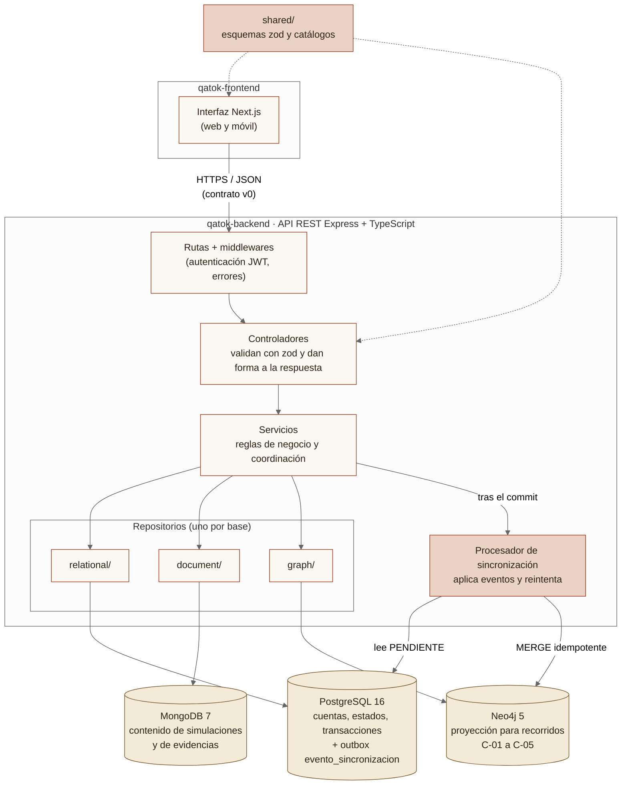
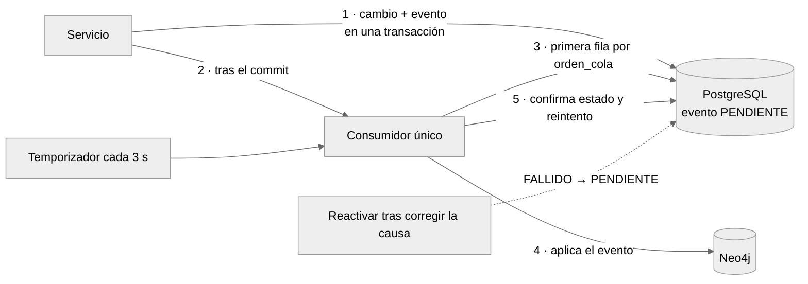
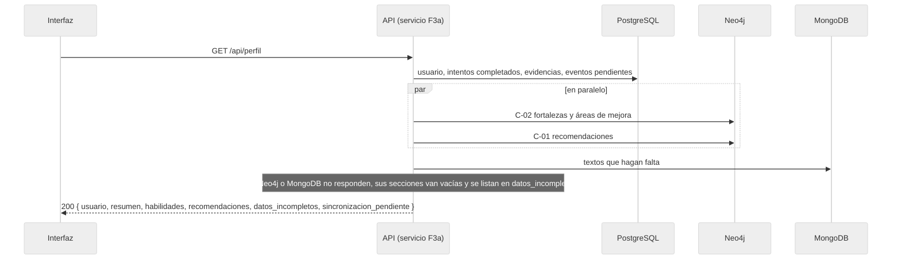

# Arquitectura y selección tecnológica — QATO'K (E3)

- **Entregable:** E3 (guía §7.3): diagrama de arquitectura, responsabilidades de cada capa, tecnologías por componente, matriz de comparación del stack, y fuente de verdad con estrategia de sincronización. Issue backend #10, perfil A.
- **Estado:** PROPUESTA. Necesita la revisión de B y C. Las decisiones que cita conservan su propio estado (§9).
- **Criterio de aceptación de la guía:** la arquitectura muestra cómo la aplicación accede a las tres bases y cómo se coordinan las operaciones.
- **Fuentes:** `docs/modelos/matriz-propiedad.md` (qué dato vive en qué base), `docs/modelos/analisis-matriz.md` (alternativas descartadas), `docs/decisiones-modelado.md` (DEC-24), `docs/api/contrato-v0.md` y el código de `backend/`.

## 1. Vista general

La interfaz solo habla con la API. La API recibe la petición, un servicio decide qué hacer y cada repositorio habla con una sola base. Cuando una operación necesita más de una base, el servicio coordina las llamadas y arma una única respuesta (guía §8).



**Cómo se lee:** las flechas continuas son llamadas en tiempo de ejecución; las punteadas, código compartido en tiempo de compilación. Ninguna flecha va de la interfaz a una base: la interfaz no tiene drivers ni credenciales (§4).

## 2. Responsabilidades por capa

| Capa | Dónde vive | Hace | No hace |
|---|---|---|---|
| **Interfaz** | repo `qatok-frontend` (Next.js) | Pantallas de los flujos F1, F2, F3a y F3b; llama a la API con `NEXT_PUBLIC_API_URL`; valida formularios con los esquemas de `shared/` | No importa `pg`, `mongodb` ni `neo4j-driver` (ESLint lo bloquea); no usa Route Handlers ni Server Actions como backend; no guarda credenciales de bases |
| **Rutas y middlewares** | `backend/src/routes/`, `middlewares/` | Expone `/api/*`; verifica el JWT y el rol; convierte los errores al formato `{ error: { codigo, mensaje } }` | No contiene reglas de negocio |
| **Controladores** | `backend/src/controllers/` | Validan la entrada con zod, llaman al servicio y dan forma a la respuesta del contrato | No consultan bases |
| **Servicios** | `backend/src/services/` | Reglas de negocio; deciden qué bases tocar y en qué orden (matriz §4); compensan si falla la segunda escritura; arman respuestas que combinan bases | No conocen SQL, MQL ni Cypher: dependen de interfaces de repositorio |
| **Repositorios** | `backend/src/repositories/{relational,document,graph}/` | Cada uno habla con **una** base; consultas siempre parametrizadas; convierten tipos del driver al formato de la API | No llaman a otros repositorios ni deciden reglas |
| **Sincronización** | `backend/src/sync/` + `repositories/graph/sincronizacion.repository.ts` + `database/graph/eventos/` | Catálogo de eventos, aplicación inmediata tras el commit, reintento de PENDIENTE y FALLIDO | No decide reglas de negocio: solo proyecta lo que PostgreSQL ya confirmó |
| **Contrato compartido** | `shared/` (copia de solo lectura en el frontend) | Esquemas zod y catálogos de valores: una sola definición para API e interfaz | No tiene lógica |
| **Scripts de base** | `database/{relational,document,graph,seed}/` | Esquemas, validadores, carga desde el dataset común, consultas y pruebas por base | No los usa la API en tiempo de ejecución, salvo el Cypher de `database/graph/` que el repositorio de grafo lee |

Ejemplo de la plantilla de capas ya implementada: `GET /api/health` (`health.routes.ts` → `health.controller.ts` → `health.service.ts` → un repositorio por base).

## 3. Responsabilidad de cada base

Resumen de `matriz-propiedad.md` §2 y §3. **Cada dato tiene una sola base dueña.**

| Base | Pregunta que responde | Es dueña de | Por qué no otra |
|---|---|---|---|
| **PostgreSQL** | ¿Qué registro existe, en qué estado está y qué operación debe ser atómica? | Usuarios y roles, habilidades, metadatos y estado de simulaciones, `simulacion_habilidad`, intentos, respuestas, registro de evidencias, comparticiones, `evento_sincronizacion` | Sin ella se pierde la transacción «respuesta + cierre del intento + evento» y la unicidad de correo, token y secuencia |
| **MongoDB** | ¿Qué información flexible o anidada pertenece a ese registro? | `contenidos_simulacion` (pasos → opciones → consecuencias + retroalimentación; `contexto` distinto por tipo de paso) y `evidencias` (instantánea) | Sin ella, el árbol de contenido serían 5 o más tablas con columnas nulas, reensambladas en cada lectura |
| **Neo4j** | ¿Cómo se conecta con lo demás y qué rutas existen? | Solo lo derivado: `Progreso` y `DEMUESTRA`. El resto son copias parciales (ids y lo que filtran C-01..C-05) | Sin ella, C-01..C-05 serían JOIN múltiples o CTE recursivas |

Detalle por entidad y por campo: `matriz-propiedad.md` §3. Modelo del grafo: `docs/modelos/grafo.md`.

## 4. Tecnologías elegidas

| Componente | Tecnología | Versión en el proyecto | Para qué |
|---|---|---|---|
| Base relacional | PostgreSQL | 16 (imagen `postgres:16-alpine`) | Cuentas, estados, transacciones y outbox |
| Base documental | MongoDB | 7 (imagen `mongo:7`) | Contenido anidado con validación `$jsonSchema` |
| Base de grafos | Neo4j Community | 5.26 (imagen `neo4j:5-community`) | Recorridos C-01..C-05 |
| API | Node.js + TypeScript + Express | Node ≥ 22, Express 5 | API REST, servicios y repositorios |
| Drivers | `pg`, `mongodb`, `neo4j-driver` | oficiales de cada motor | Acceso desde los repositorios |
| Validación y contrato | zod en `shared/` | zod 4 | Mismo esquema en API e interfaz |
| Autenticación | JWT + bcrypt (costo 10) | — | Sesión sin estado; roles ESTUDIANTE y ADMIN |
| Registro | pino (JSON) | pino 10 | Logs sin contraseñas, tokens ni correos |
| Interfaz | Next.js | — (repo `qatok-frontend`, en construcción) | Web adaptable a móvil (RF-10) |
| Pruebas | vitest + supertest; scripts Cypher | vitest 5 | Unitarias, integración contra las 3 bases, pruebas por base |
| Entorno | Docker Compose | — | Las 3 bases con un comando (`npm run db:up`) |
| Integración continua | GitHub Actions | — | Levanta las 3 bases y corre lint, tipos y todas las pruebas en cada PR |

## 5. Matriz de comparación del stack

**Criterios** (los mismos para todos los componentes):
- **G · Guía:** cumple lo que pide la guía (tres paradigmas distintos, API como único punto de acceso, sin infraestructura distribuida innecesaria).
- **F · Función:** resuelve la necesidad concreta de QATO'K (§3).
- **D · Driver:** tiene driver oficial y estable para Node.js.
- **E · Equipo:** el equipo ya lo conoce o lo vio en clase.
- **O · Operación:** se levanta en local con Docker sin configuración especial.

### Base relacional

| Opción | A favor | En contra | Decisión |
|---|---|---|---|
| **PostgreSQL 16** | `CHECK`, índices únicos sobre expresiones (`lower(correo)`), `JSONB` y bloqueos transaccionales para el outbox, `TIMESTAMPTZ` | — | **Elegida** |
| MySQL 8 | También ofrece transacciones, `CHECK` y `SKIP LOCKED` | No aporta nada que falte en PostgreSQL, que ya era la base relacional del modelo desde la actividad anterior (KG v1.1) | Viable, no elegida |
| SQLite | Sin servidor, muy simple | Un solo escritor a la vez; no es un servicio de red, así que no representa una base en la nube | Descartada por F y G |

### Base documental

| Opción | A favor | En contra | Decisión |
|---|---|---|---|
| **MongoDB 7** | Documentos anidados que se leen y validan como unidad (`$jsonSchema` por tipo de paso); driver oficial | Las relaciones entre documentos son débiles (no las necesita: viven en PostgreSQL y Neo4j) | **Elegida** |
| `JSONB` dentro de PostgreSQL | Una base menos | Deja la aplicación sin modelo documental: la guía lo exige (alternativa M4 de `analisis-matriz.md`) | Descartada por G |
| Cassandra | Escala horizontal | Modelo por columnas pensado por consulta, sin validación de documentos anidados; pesado de operar en local | Descartada por F y O |

### Base de grafos

| Opción | A favor | En contra | Decisión |
|---|---|---|---|
| **Neo4j 5 Community** | Cypher expresa C-01..C-05 como patrones; restricciones de unicidad; es la base de las actividades de refuerzo de la guía (§6.2) | Community no tiene restricciones de existencia: se compensan con PostgreSQL y pruebas (`database/graph/tests/`) | **Elegida** |
| ArangoDB | Multimodelo (documentos y grafos) | Mezclaría responsabilidades en una sola base y debilitaría la justificación de cada paradigma | Descartada por G |
| CTE recursivas en PostgreSQL | Sin base extra | Recorridos y recomendaciones con JOIN múltiples o recursión; deja la aplicación sin modelo de grafos (alternativa M2 descartada) | Descartada por G y F |

### API

| Opción | A favor | En contra | Decisión |
|---|---|---|---|
| **Express 5 + TypeScript** | Mínimo y conocido; mismo lenguaje que la interfaz, así que los esquemas zod se comparten (`shared/`) | La estructura de capas hay que imponerla con convenciones (plantilla `/api/health`) | **Elegida** (D-20) |
| NestJS | Capas, inyección de dependencias y módulos ya resueltos | Más código de arranque y una curva de aprendizaje que no aporta a la evaluación | Descartada por E |
| FastAPI (Python) | Validación y documentación automáticas | Otro lenguaje: no se pueden compartir tipos con la interfaz | Descartada por E y F |

### Estilo de API

| Opción | A favor | En contra | Decisión |
|---|---|---|---|
| **REST + JSON** | Simple de probar (supertest, navegador); contrato v0 por endpoint; errores y códigos HTTP explícitos | Algunas pantallas requieren varias llamadas (el perfil las agrupa en `GET /api/perfil`) | **Elegida** |
| GraphQL | La interfaz pide exactamente lo que necesita | Otra capa (esquema y resolvers) sobre los servicios; la guía acepta ambos | Descartada por O |

### Interfaz

| Opción | A favor | En contra | Decisión |
|---|---|---|---|
| **Next.js** | Elegido por quien construye la interfaz; web adaptable a móvil | Puede ejecutar código de servidor y tentaría a tocar las bases: se bloquea con ESLint y reglas del contrato | **Elegida** (D-20) |
| React + Vite (SPA) | Más simple, solo cliente | — (alternativa válida; el responsable eligió Next.js) | No elegida |
| App móvil nativa | Experiencia móvil completa (RF-10) | Duplica trabajo; una web adaptable cubre sesiones cortas en el móvil | Descartada por O |

### Sincronización hacia Neo4j

Comparación completa en `analisis-matriz.md` §3.

| Opción | Problema | Decisión |
|---|---|---|
| Escritura doble síncrona | Si Neo4j cae, no se puede jugar; si falla tras el commit, no hay cómo deshacer | Descartada |
| Outbox asíncrono puro | El perfil tarda en actualizarse: en la demo parece un error | Insuficiente sola |
| **Outbox + aplicación inmediata + reintento** | — | **Elegida** (D-17) |
| CDC (Debezium y Kafka) | Dos servicios más; la guía no pide infraestructura distribuida | Descartada |
| Reconstrucción completa | Lenta y deja el grafo vacío mientras corre | Último recurso |

### Entorno

| Opción | A favor | En contra | Decisión |
|---|---|---|---|
| **Docker Compose** | Las 3 bases con un comando, iguales en las 3 máquinas y en CI | Requiere Docker Desktop | **Elegida** (D-20) |
| Instalación local de cada motor | Sin Docker | Versiones distintas en cada máquina; la instalación cruzada (puerta 4) fallaría | Descartada |
| Servicios gestionados (Neon, Atlas, Aura) | Sin servidores propios | Tres cuentas y credenciales que compartir; no hace falta para desarrollar | **Pendiente**: opción para el despliegue (E8) |

## 6. Fuente de verdad y sincronización

### Reglas (matriz §1)
1. **Cada dato tiene una sola base dueña.** Solo ahí se modifica oficialmente.
2. **Una entidad existe cuando existe su registro en PostgreSQL.** Un documento de MongoDB sin registro es un huérfano y la reconciliación lo borra.
3. **Todo cambio que deba llegar al grafo nace en PostgreSQL**, en la misma transacción que su evento (outbox).
4. **Neo4j es una proyección:** ids, relaciones y solo las propiedades que usan C-01..C-05. Es dueño de lo derivado (`Progreso`, `DEMUESTRA`).
5. **El contenido publicado es inmutable** (D-19), así que la estructura copiada al grafo no se desfasa.
6. **Una base por operación siempre que se pueda.** Solo dos operaciones escriben en dos bases y su peor caso es un huérfano inofensivo.

### Operaciones que escriben en más de una base

| Operación | Orden | Si falla la segunda escritura |
|---|---|---|
| Generar evidencia (F3a) | 1) MongoDB `evidencias` → 2) PostgreSQL `evidencia` + evento | Se borra el documento (compensación); si también falla, la reconciliación lo limpia |
| Eliminar un BORRADOR o una evidencia | 1) PostgreSQL → 2) MongoDB | Queda un documento huérfano; la reconciliación lo limpia |

Las demás operaciones escriben en una sola base dueña. La copia al grafo no cuenta como segunda escritura: la hace el outbox.

### Cómo llega un cambio al grafo



- **Aplicación inmediata:** la petición puede avanzar la misma cola que usa el temporizador. La API responde `grafo: "APLICADO"` cuando PostgreSQL confirma el estado de todos los eventos de esa petición.
- **Reintento:** el cambio de negocio sigue confirmado si Neo4j no responde. PostgreSQL conserva la próxima fecha de intento y la API informa `grafo: "PENDIENTE"`. Si se agotan los reintentos, la cola se pausa en la primera fila. Tras corregir el problema, el comando local permite reactivarla.
- **Idempotencia:** cada evento es un `MERGE` por id; aplicarlo dos veces da el mismo grafo. `Progreso` se recalcula desde cero, nunca se incrementa.
- **Reconciliación** (`npm run reconciliar`, matriz §6): compara ids entre PostgreSQL y Neo4j, reintenta FALLIDO, borra huérfanos de MongoDB y recalcula `Progreso`.
- **Reconstrucción** (`npm run grafo:reconstruir`): último recurso; vacía el grafo y lo rehace desde PostgreSQL y MongoDB.

**Estado de implementación:** catálogo, aplicador de los 11 eventos, outbox en PostgreSQL y procesador conectado al arranque. Faltan conectar los servicios de negocio como productores y completar la reconciliación general entre las bases.

## 7. Flujos integrados (diseño)

Dos flujos equivalentes al ejemplo de la guía §8.1. Son **diseño**: la parte de Neo4j está implementada; la de PostgreSQL y MongoDB, no todavía.

### F2 · Responder un paso (escritura coordinada)

```mermaid
%%{init: {'theme': 'neutral'}}%%
sequenceDiagram
  participant UI as Interfaz
  participant API as API (servicio F2)
  participant MG as MongoDB
  participant PG as PostgreSQL
  participant NJ as Neo4j
  UI->>API: POST /api/intentos/:id/respuestas { id_paso, id_opcion }
  API->>PG: el intento es del usuario y está EN_CURSO
  API->>MG: lee el paso y la opción del contenido
  Note over API: valida RI-10 (la opción es del paso)
  API->>PG: BEGIN · respuesta · cierre del intento si la opción es terminal · eventos · COMMIT
  API->>NJ: aplica RESPUESTA_REGISTRADA (e INTENTO_FINALIZADO)
  alt Neo4j responde
    API->>PG: eventos APLICADO
  else Neo4j no responde
    Note over API,PG: eventos PENDIENTE; el reintento los aplicará
  end
  API-->>UI: 201 { consecuencias, retroalimentacion, sincronizacion }
```

### F3a · Ver el perfil (lectura que combina las tres bases)



- Sin PostgreSQL la respuesta es `503`, porque sin la cuenta no hay perfil. Sin Neo4j o MongoDB el perfil se muestra igual, con aviso de datos incompletos (contrato v0, F3a).
- `sincronizacion_pendiente > 0` le dice a la interfaz que el progreso se está actualizando.

## 8. Seguridad y configuración

- **Credenciales solo en el backend:** variables de entorno validadas al arrancar (`backend/src/config/entorno.ts`); `npm run setup:env` genera secretos aleatorios. La interfaz solo conoce la URL de la API.
- **Acceso:** JWT firmado con `JWT_SECRET` (≥ 32 caracteres). Niveles del contrato: público, usuario, dueño (si el recurso no es suyo responde `404` y no revela que existe) y administrador.
- **Contraseñas:** solo `contrasena_hash` con bcrypt; nunca en logs ni en respuestas. pino oculta contraseñas, tokens y encabezados de autorización.
- **Consultas parametrizadas** en las tres bases (`$1` en `pg`, filtros como objeto en `mongodb`, `$param` en Neo4j); el SQL, el MQL y el Cypher solo viven en `repositories/` y `database/`.
- **Privacidad (RF-09):** el correo no se copia al grafo; compartir una evidencia usa un token con vencimiento y revocación.

## 9. Decisiones y su estado

| Decisión | Qué decide | Estado |
|---|---|---|
| D-15 | MongoDB se adopta como base documental | ADOPTADA |
| D-16 | Cada dato tiene una base dueña; PostgreSQL es dueño de cuentas, estados y transacciones; Neo4j es una proyección | PRELIMINAR (aprobación del equipo, issue #2) |
| D-17 | Outbox con aplicación inmediata, reintento idempotente, reconciliación y reconstrucción | PRELIMINAR |
| D-18 | `Consecuencia`, `Retroalimentacion` y `Comparticion` salen del grafo | PRELIMINAR |
| D-19 | El contenido publicado es inmutable | PRELIMINAR |
| D-20 | Stack: Express + TypeScript, Next.js que solo consume la API, Docker Compose | ADOPTADA |
| D-21 | Puntuación del intento = promedio de las valoraciones elegidas | PROPUESTA (P-03) |
| DEC-25 | Fórmula de `Progreso.nivel_actual` (último intento completado por simulación, ponderado por peso) | PROPUESTA (P-03) |

**Pendientes que afectan a la arquitectura:** P-04 (ciclos entre pasos), P-10 (seguridad), P-11 (escalabilidad) y el destino de despliegue (§5, Entorno). Propuestas abiertas para el equipo: sacar `Evidencia.titulo` del grafo y agregar `proximo_intento` a `evento_sincronizacion` (PR #34).
