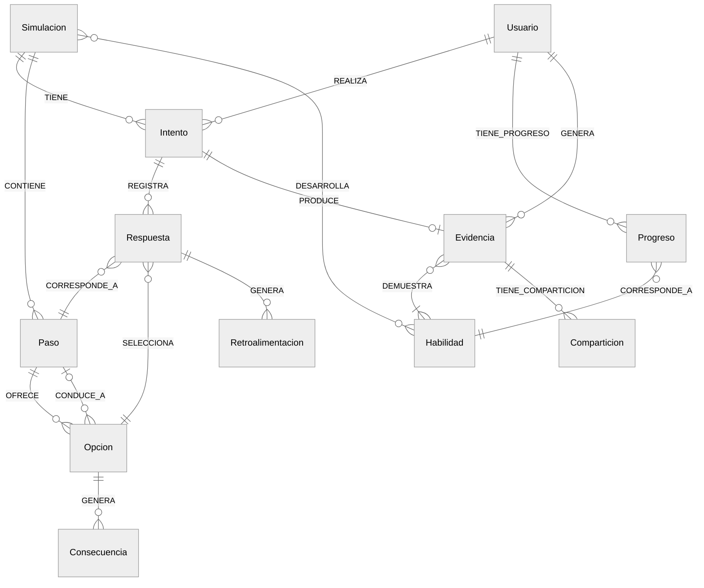

# E2. Modelo conceptual común de QATO'K

El modelo describe a los usuarios que juegan simulaciones, las decisiones que toman y las evidencias que pueden compartir. Las 12 entidades y 17 relaciones proceden del KG v1.2. El [diccionario de datos](diccionario.md) indica dónde se materializa cada entidad y cómo se verifica cada regla. [KG v1.2](../KG.json)

## Entidades y relaciones

El diagrama muestra las relaciones del dominio. Refleja los mínimos que admite un borrador para sus pasos, opciones y consecuencias, y el máximo de una evidencia por intento. La tabla conserva las cardinalidades generales del KG y las notas precisan las reglas de publicación y persistencia.

**Lectura de la tabla.** «Destinos por origen» indica cuántos intentos realiza un usuario en R01. «Orígenes por destino» indica a cuántos usuarios pertenece un intento.

| ID | Origen | Relación | Destino | Destinos por origen (KG) | Orígenes por destino (KG) |
|---|---|---|---|---|---|
| R01 | Usuario | REALIZA | Intento | 0..N | 1..1 |
| R02 | Simulacion | TIENE | Intento | 0..N | 1..1 |
| R03 | Simulacion | CONTIENE | Paso | 0..N | 1..1 |
| R04 | Simulacion | DESARROLLA | Habilidad | 0..N | 0..N |
| R05 | Paso | OFRECE | Opcion | 1..N | 1..1 |
| R06 | Opcion | GENERA | Consecuencia | 1..N | 1..1 |
| R07 | Opcion | CONDUCE_A | Paso | 0..1 | 0..N |
| R08 | Intento | REGISTRA | Respuesta | 0..N | 1..1 |
| R09 | Respuesta | CORRESPONDE_A | Paso | 1..1 | 0..N |
| R10 | Respuesta | SELECCIONA | Opcion | 1..1 | 0..N |
| R11 | Respuesta | GENERA | Retroalimentacion | 0..N | 1..1 |
| R12 | Usuario | TIENE_PROGRESO | Progreso | 0..N | 1..1 |
| R13 | Progreso | CORRESPONDE_A | Habilidad | 1..1 | 0..N |
| R14 | Usuario | GENERA | Evidencia | 0..N | 1..1 |
| R15 | Intento | PRODUCE | Evidencia | 0..N | 1..1 |
| R16 | Evidencia | DEMUESTRA | Habilidad | 1..N | 0..N |
| R17 | Evidencia | TIENE_COMPARTICION | Comparticion | 0..N | 1..1 |

## Reglas que acotan el modelo en la entrega

- **R03–R06.** El editor admite borradores incompletos. Publicar exige al menos un paso, una habilidad, una opción por paso y una consecuencia por opción. Cada borrador admite hasta 30 pasos, 6 opciones por paso y 3 consecuencias por opción. `DESARROLLA` lleva `peso` y `nivel_esperado`, registrados por par simulación–habilidad.
- **R07.** La opción puede apuntar a un paso de la misma revisión o finalizar el intento. La publicación valida que todos los pasos sean alcanzables desde `orden = 1` y que las rutas sean acíclicas.
- **R11.** Al responder, la API devuelve la retroalimentación de la opción elegida. En MongoDB es un objeto de esa opción y en la proyección se conserva su tipo sobre la respuesta.
- **R12–R13.** Se consolida un progreso por par usuario–habilidad. La fórmula en uso se documenta como propuesta en DEC-25.
- **R15–R16.** PostgreSQL admite como máximo una evidencia por intento completado. La relación `DEMUESTRA` se deriva de las habilidades asociadas a la simulación de ese intento.
- **R17.** Una evidencia admite varios enlaces. La API comprueba el estado y el vencimiento del enlace al servirla.

## Correspondencia con los modelos lógicos

| Modelo | Responsabilidad | Documento |
|---|---|---|
| Relacional | Identidad, titularidad, estados y operaciones transaccionales. | [PostgreSQL](relacional.md) |
| Documental | Borradores, revisiones publicadas e instantáneas del recorrido. | [MongoDB](documental.md) |
| Grafo | Proyección para las consultas C-01 a C-05 y datos derivados de progreso. | [Neo4j](grafo.md) |

Los UUID vinculan los datos entre motores. PostgreSQL señala la revisión vigente de MongoDB y registra los eventos que actualizan Neo4j. La [matriz de propiedad](matriz-propiedad.md) especifica qué dato pertenece a cada base y cómo se reconstruyen sus copias. [Arquitectura](../arquitectura.md)
