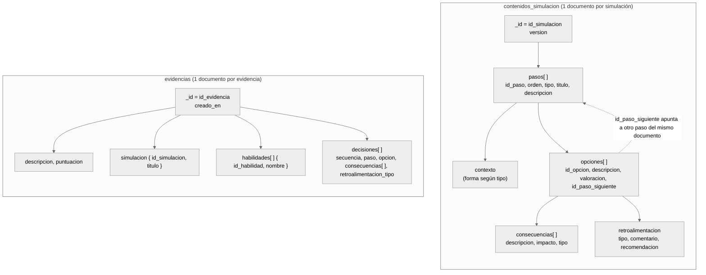

# Modelo lógico documental — QATO'K (v2, MongoDB)

- **Entregable:** E2, modelo documental (guía: «colecciones, estructura de documentos, anidamiento y validaciones»; además estrategia de identificación e índices). Issue backend #20, perfil C.
- **Estado:** PROPUESTA. Necesita la revisión de A y B. Las decisiones que tocan a otros perfiles están en §8 y se avisan en el PR.
- **Fuentes:** `docs/modelos/matriz-propiedad.md` §2 a §6, `docs/modelos/grafo.md`, `context/convenciones.md` §1 a §6, `docs/api/contrato-v0.md`, `docs/KG.json` (propiedades y reglas RI) y `database/seed/dataset.json` (sección `documental`).
- **Qué NO es:** no implementa nada. Los validadores, la carga y las pruebas son el issue #19; el repositorio es el #21; la F2 del backend es el #22. Los `$jsonSchema` de los anexos A y B son la **especificación normativa** que #19 copia a `database/document/validators/`.
- **Cómo se verificó:** los anexos A y B se probaron con un emulador de JSON Schema (borrador 4, el subconjunto que usa MongoDB) contra el dataset y contra 46 casos inválidos. **No se ejecutó contra un `mongod` real**; #19 lo confirma (§9).

## 1. Papel de MongoDB

MongoDB guarda el **contenido** de dos entidades cuyo registro (existencia, estado, dueño) vive en PostgreSQL. No es dueño de ningún registro por sí solo: un documento sin su fila en PostgreSQL es un **huérfano** y la reconciliación lo elimina (matriz, regla 2 y §6).

| Colección | Contenido | Registro en PostgreSQL | Quién escribe |
|---|---|---|---|
| `contenidos_simulacion` | Pasos, opciones, consecuencias y retroalimentación de una simulación, con un `contexto` que cambia según el tipo de paso | `simulacion` | F1 (B): cargar o editar contenido y eliminar un BORRADOR. F2 y F3a solo leen |
| `evidencias` | Instantánea autocontenida del recorrido de un intento completado | `evidencia` | F3a (A): generar y eliminar evidencia. F1 (B): borrar las evidencias de una cuenta eliminada. F3b solo lee |

### Por qué estos datos son documentales

Es la prueba de suficiencia de la guía (§4.2), tomada de la matriz §2:

- **Contenido de la simulación.** Es un árbol (simulación → pasos → opciones → consecuencias) que se **guarda, lee y valida como una unidad**, y la forma del `contexto` depende del `tipo` del paso (5 formas). En SQL serían 5 o más tablas con columnas nulas, reensambladas en cada lectura.
- **Evidencia.** Es una instantánea: copia el título de la simulación, el nombre de las habilidades y el texto de cada decisión **en el momento de generarla**, y se lee completa en una sola lectura (F3b). No guarda datos personales (ni nombre, ni correo, ni `id_usuario`).

## 2. Diagrama de los documentos



## 3. Estrategia de identificación

| Regla | Detalle |
|---|---|
| `_id` | El **UUID v4 como string**, el mismo de la entidad (`convenciones` §1). En `contenidos_simulacion`, `_id = id_simulacion`; en `evidencias`, `_id = id_evidencia`. Nunca `ObjectId` |
| Formato | Una sola expresión regular, la de `validar_dataset.py`: `^[0-9a-f]{8}-[0-9a-f]{4}-4[0-9a-f]{3}-[89ab][0-9a-f]{3}-[0-9a-f]{12}$`. La usan el `$jsonSchema`, zod (`shared/`) y el dataset |
| Quién lo genera | El backend, antes de escribir. Si `PUT contenido` llega sin ids de paso u opción, el servicio los genera (contrato) **antes** de validar y escribir |
| Ids anidados | `id_paso` e `id_opcion` son UUID string y los usa el grafo (`Paso`, `Opcion`, `CONDUCE_A`); no cambian después de publicar. `id_consecuencia` es opcional (decisión D4) |
| Unicidad dentro del documento | `id_paso`, `id_opcion` y `orden` no se repiten en un documento. `$jsonSchema` no puede comprobarlo: lo hace el servicio al guardar |
| **Unicidad entre documentos** | `id_paso` e `id_opcion` son **únicos en toda la colección**, porque el grafo tiene `paso_id` y `opcion_id` únicos globales (`grafo.md` §5) y un id repetido fundiría pasos de dos simulaciones con `MERGE`. Lo garantizan dos **índices únicos multikey** (§7.2). Es el caso de copiar el contenido de una simulación a otra con los mismos ids |
| Relación con PostgreSQL | Mismo id en las dos bases. `respuesta.id_paso` e `id_opcion` en PostgreSQL son **referencias blandas** al contenido: no tienen FK (matriz §3, E08) |
| Campos de control | `version` (contenido) y `creado_en` (evidencia) los escribe el servicio, no el cliente. El dataset **no se modifica**: el cargador (#19) agrega `version: 1` a cada contenido y toma `creado_en` de `relacional.evidencia.fecha_generacion` del mismo id |
| Datos de prueba | Prefijo `e0000000-0000-4000-8000-` (`convenciones` §1) |

## 4. Colección `contenidos_simulacion`

Un documento por simulación. Origen de cada campo: matriz §3; ejemplo real en `dataset.json`. Esquema normativo: **Anexo A**.

### 4.1 Campos

Todos son obligatorios salvo donde se indica. No se admiten campos que no estén en la tabla (`additionalProperties: false` en cada nivel). Los textos van **sin HTML**: son texto plano, y la interfaz los muestra como texto.

| Ruta | Tipo BSON | Reglas |
|---|---|---|
| `_id` | string | UUID v4 (§3) |
| `version` | number entero | ≥ 1. Control de concurrencia (§7.4). Lo escribe el servicio |
| `pasos` | array | 0 a 30 elementos. **Puede ir vacío en BORRADOR** (§4.3) |
| `pasos[].id_paso` | string | UUID v4 |
| `pasos[].orden` | number entero | ≥ 1, único en el documento (RI-18). El paso con `orden = 1` es el inicial |
| `pasos[].tipo` | string | `CORREO`, `REUNION`, `CONVERSACION`, `TAREA` o `INCIDENTE` |
| `pasos[].titulo` | string | 1 a 150 caracteres, con al menos un carácter que no sea espacio |
| `pasos[].descripcion` | string | 1 a 1000 |
| `pasos[].contexto` | object | Su forma depende de `tipo` (§4.2) |
| `pasos[].opciones` | array | 0 a 6 elementos (mínimo 1 al publicar) |
| `…opciones[].id_opcion` | string | UUID v4 |
| `…opciones[].descripcion` | string | 1 a 1000 |
| `…opciones[].valoracion` | number | 0 a 100. Obligatoria (decisión D5). Los 2 decimales máximos los comprueba zod, no MongoDB |
| `…opciones[].id_paso_siguiente` | string o null | UUID v4 de **otro** paso del mismo documento (RI-11); `null` = opción terminal, completa el intento (RI-23). El campo siempre va, aunque sea `null` |
| `…opciones[].consecuencias` | array | 0 a 3 elementos (mínimo 1 al publicar) |
| `…consecuencias[].id_consecuencia` | string | **Opcional**, UUID v4 (decisión D4) |
| `…consecuencias[].descripcion` | string | 1 a 1000 |
| `…consecuencias[].impacto` | string | `POSITIVO`, `NEUTRO` o `NEGATIVO` |
| `…consecuencias[].tipo` | string | `RELACIONAL`, `TIEMPO`, `CALIDAD` o `REPUTACION` |
| `…opciones[].retroalimentacion` | object | Una por opción. `tipo` (`ACIERTO`, `PARCIAL` o `ERROR`; se copia al grafo como `Respuesta.tipo_retroalimentacion`), `comentario` (1 a 1000) y `recomendacion` (1 a 1000) |

### 4.2 `contexto` según el tipo de paso

Fuente: `convenciones` §4. Cada tipo tiene **solo** sus campos: un `CORREO` con `agenda` es inválido. Los arreglos del contexto llevan siempre al menos 1 elemento: es forma, no conteo de RI-17.

| `tipo` | Campos de `contexto` | Topes |
|---|---|---|
| `CORREO` | `remitente`, `asunto`, `cuerpo` (strings) | 200, 200 y 5000 caracteres |
| `REUNION` | `participantes[]`, `agenda[]` (arreglos de strings) | 1 a 20 elementos de 150; 1 a 20 de 300 |
| `CONVERSACION` | `interlocutor` (string), `lineas[]` de `{ quien, texto }` (strings) | 150; 1 a 50 líneas de 100 y 1000 |
| `TAREA` | `entregables[]` (strings), `plazo_horas` (número > 0 y ≤ 8760) | 1 a 20 de 300 |
| `INCIDENTE` | `cronologia[]` de `{ momento, hecho }` (strings), `severidad` (`BAJA`, `MEDIA` o `ALTA`) | 1 a 50 de 100 y 1000 |

### 4.3 BORRADOR frente a publicada

La completitud se exige **al publicar** (RI-17 es «validación al publicar» y el contrato responde `409 CONTENIDO_INCOMPLETO`), no al guardar. Un borrador se edita por partes, así que MongoDB valida solo la **forma** de lo que ya existe: tipos, catálogos, longitudes y topes. Los mínimos de pasos, opciones y consecuencias no están en el `$jsonSchema`.

| Momento | Qué se comprueba | Error |
|---|---|---|
| `PUT contenido` (BORRADOR) | Forma (zod y `$jsonSchema`); `id_paso`, `id_opcion` y `orden` sin repetir dentro del documento; ids sin repetir en otros documentos (§7.2) | `400 VALIDACION` con `detalles` |
| `POST publicar` | Existe el documento; RI-17: ≥ 1 paso, cada paso ≥ 1 opción, cada opción ≥ 1 consecuencia, ≥ 1 habilidad (PostgreSQL); RI-18: `orden` único y existe `orden = 1`; RI-11: cada `id_paso_siguiente` existe en el mismo documento y no es el paso propio | `409 SIN_CONTENIDO`, `409 CONTENIDO_INCOMPLETO`, `409 RAMIFICACION_INVALIDA` |

Un `id_paso_siguiente` que todavía no existe es válido en un borrador (se está armando la ruta) y se rechaza al publicar.

## 5. Colección `evidencias`

Un documento por evidencia: la instantánea del recorrido. Se escribe una vez al generar la evidencia y no se edita (si el estudiante cambia el título o la visibilidad, eso es PostgreSQL). Esquema normativo: **Anexo B**.

| Ruta | Tipo BSON | Reglas |
|---|---|---|
| `_id` | string | UUID v4 = `id_evidencia` |
| `descripcion` | string | 1 a 5000. La redacta el servicio de F3a a partir del recorrido (decisión D5b) |
| `simulacion.id_simulacion` | string | UUID v4 |
| `simulacion.titulo` | string | 1 a 150. Copia del título **al generar** |
| `puntuacion` | number | 0 a 100. Copia de `intento.puntuacion` |
| `habilidades` | array | 1 a 20. Cada elemento `{ id_habilidad (UUID), nombre (1 a 150) }`: las que desarrolla la simulación (RI-20) |
| `decisiones` | array | 1 a 100, en orden de `secuencia` |
| `decisiones[].secuencia` | number entero | ≥ 1 |
| `decisiones[].paso` | object | `{ titulo (1 a 150), tipo (catálogo de tipos de paso) }` |
| `decisiones[].opcion` | string | Texto de la opción elegida (1 a 1000) |
| `decisiones[].consecuencias` | array de string | 1 a 3 textos (toda opción publicada tiene al menos una: RI-17) |
| `decisiones[].retroalimentacion_tipo` | string | `ACIERTO`, `PARCIAL` o `ERROR` |
| `creado_en` | date | Instante en que se escribió el documento. Lo usa la reconciliación (§6, decisión D2). Lo escribe el servicio |

- No tiene `id_usuario` ni `id_intento`: el dueño y el intento viven en PostgreSQL (`evidencia.id_usuario`, `evidencia.id_intento`).
- No guarda `id_paso` ni `id_opcion`: es **autocontenida a propósito**, para que siga siendo legible aunque cambie el catálogo. Por eso la reconciliación no puede cruzar sus decisiones con el contenido; solo cruza `_id` con PostgreSQL.
- Al eliminar una cuenta, el servicio lee de PostgreSQL los `id_evidencia` del usuario **antes** de la transacción que borra en cascada, y después borra esos `_id` en MongoDB. Si el borrado en MongoDB falla, no quedan ids que leer: las evidencias huérfanas las encuentra la reconciliación comparando los `_id` de MongoDB con PostgreSQL.

## 6. Operaciones y consultas

Origen de las operaciones: matriz §4 y contrato v0. Las formas están en notación de `mongosh`; el repositorio documental (#21) las implementa. **Todas las consultas de la ruta de una petición usan un índice** (columna «Plan»). Las únicas excepciones son los recorridos completos de validación del anexo C, que solo corren en pruebas y en la reconciliación.

Reglas de código (`convenciones` §6): el filtro es siempre un objeto armado por el repositorio, y cada id llega **ya validado como UUID string** (tipo `Uuid` con la regex de §3). Un valor como `{ "$ne": null }` en el cuerpo de una petición nunca llega a un filtro, porque no pasa zod ni es string.

| # | Operación (flujo) | Consulta | Plan |
|---|---|---|---|
| Q1 | Leer el contenido completo (admin, F1) | `findOne({ _id })` | IXSCAN `_id` |
| Q2 | Paso inicial (F2: iniciar o retomar un intento sin respuestas) | `findOne({ _id, "pasos.orden": 1 }, { projection: { "pasos.$": 1 } })` | IXSCAN `_id` |
| Q3 | Un paso por id: el paso respondido y el `siguiente_paso` (F2) | `findOne({ _id, "pasos.id_paso": idPaso }, { projection: { "pasos.$": 1 } })` | IXSCAN `_id` |
| Q4 | Paso que contiene una opción (F2: paso actual al retomar, desde la última respuesta de PostgreSQL) | `findOne({ _id, "pasos.opciones.id_opcion": idOpcion }, { projection: { "pasos.$": 1 } })` | IXSCAN `_id` |
| Q5 | Cargar o editar contenido (F1) | Lee la versión: `findOne({ _id }, { projection: { version: 1 } })`. Si no existe: `insertOne({ …, version: 1 })`. Si existe: `replaceOne({ _id, version: n }, { …, version: n + 1 })` | IXSCAN `_id` |
| Q6 | Comprobar ids de otras simulaciones antes de guardar (F1) | `find({ _id: { $ne: _id }, $or: [{ "pasos.id_paso": { $in: idsPaso } }, { "pasos.opciones.id_opcion": { $in: idsOpcion } }] }, { projection: { _id: 1 } })` | IXSCAN en los dos índices únicos (§7.2) |
| Q7 | Eliminar un BORRADOR (F1), después del `DELETE` en PostgreSQL | `deleteOne({ _id })` | IXSCAN `_id` |
| Q8 | Recorrido de un intento, C-03 (F3a) | `aggregate([{ $match: { _id } }, { $project: { pasos: { $filter: { input: "$pasos", cond: { $in: ["$$this.id_paso", idsVisitados] } } } } }])` — una lectura por intento, no por decisión | IXSCAN `_id` |
| Q9 | Generar evidencia (F3a), antes del registro en PostgreSQL | `insertOne(documento)` | — (escritura) |
| Q10 | Ver evidencia (F3a, F3b), después de validar en PostgreSQL | `findOne({ _id })` | IXSCAN `_id` |
| Q11 | Eliminar evidencia o cuenta (F3a, F1) | `deleteOne({ _id })` / `deleteMany({ _id: { $in: ids } })` | IXSCAN `_id` |
| Q12 | Reconciliación: huérfanos de evidencias (A) | `find({ creado_en: { $lt: corte } }, { projection: { _id: 1 } })`, con `corte` = ahora − 10 min; después se compara con PostgreSQL | IXSCAN `ix_evidencias_creado_en` |
| Q13 | Reconciliación: huérfanos de contenidos (A). **Sin umbral de edad** (§5 y D2) | `find({}, { projection: { _id: 1 } }).hint({ _id: 1 })`, y se compara con PostgreSQL | IXSCAN `_id`, cubierta (sin `FETCH`) |
| Q14 | Reconciliación: referencias de PostgreSQL al contenido (A): ¿existe el paso o la opción de una respuesta? | `findOne({ "pasos.id_paso": idPaso }, { projection: { _id: 1 } })` y `findOne({ "pasos.opciones.id_opcion": idOpcion }, { projection: { _id: 1 } })` | IXSCAN en los índices únicos |
| Q15 | Reconciliación: simulaciones PUBLICADA sin contenido (A) | `findOne({ _id }, { projection: { _id: 1 } })` por simulación | IXSCAN `_id` |

### Cómo responde F2 (RI-10)

1. **Iniciar o retomar.** Si el intento no tiene respuestas: Q2. Si las tiene: la última respuesta de PostgreSQL da `id_opcion` → Q4 → el `id_paso_siguiente` de esa opción → Q3.
2. **Responder.** PostgreSQL calcula el paso actual (así sale `409 PASO_NO_ACTUAL`). Q3 trae el paso respondido; si no contiene la opción → `400 OPCION_NO_PERTENECE_AL_PASO`. Del paso salen `valoracion`, `consecuencias`, `retroalimentacion` e `id_paso_siguiente`. Si `id_paso_siguiente` no es `null`, un segundo Q3 trae el `siguiente_paso`. Solo se lee MongoDB; la respuesta se registra en PostgreSQL.
3. **Mongo caído.** Cualquier lectura que falle por conexión es `503 BASE_NO_DISPONIBLE` con `detalles.base = "documental"`.

### `PasoVista`: lista blanca

El repositorio arma `PasoVista` **copiando solo** estos campos, en lugar de quitar los prohibidos: `id_paso`, `orden`, `tipo`, `titulo`, `descripcion`, `contexto` y, por cada opción, `id_opcion` y `descripcion`. Así nunca salen `valoracion` (delataría la mejor respuesta), `consecuencias`, `retroalimentacion` ni `id_paso_siguiente` (delataría la ruta). Si el esquema crece con un campo nuevo, no se filtra solo.

## 7. Validación, índices y concurrencia

### 7.1 Qué valida MongoDB y qué valida el servicio

`$jsonSchema` valida la **forma** de un documento, pero no puede comparar partes del documento entre sí ni con otra base. Las colecciones se crean con `validationLevel: "strict"` y `validationAction: "error"`. MongoDB no admite `$ref`, `format` ni `if/then`, así que los esquemas de los anexos se generan con un script y no se editan a mano.

| Regla | Dónde se garantiza | Cómo |
|---|---|---|
| Campos obligatorios, tipos, catálogos, longitudes, topes de tamaño y rangos | **MongoDB** (anexos A y B) | `$jsonSchema`. Los `string` llevan `minLength`, `maxLength` y `pattern: "\S"` (al menos un carácter visible; `minLength` solo aceptaría `"   "`) |
| `contexto` coherente con `tipo` | **MongoDB** | `allOf` a nivel de `pasos.items` con un `oneOf` de 5 ramas; cada rama fija el `tipo` y el esquema de su `contexto`. Un `CORREO` con contexto de `REUNION` no cumple ninguna rama |
| Enteros (`orden`, `version`, `secuencia`) | **MongoDB** | `bsonType: "number"` con `multipleOf: 1`: acepta `int`, `long` y el `double` `1.0` que escribe un cargador en Python, y rechaza `1.5` |
| 2 decimales máximo en `valoracion` y `puntuacion` | **Servicio** (zod) | `multipleOf: 0.01` con `double` no es fiable |
| Mínimos de RI-17 (pasos, opciones, consecuencias) | **Servicio, al publicar** (§4.3) | `409 CONTENIDO_INCOMPLETO`. Una evidencia siempre está completa: ahí los `minItems` sí van en el esquema |
| RI-18: `orden` único y existe `orden = 1` | **Servicio** | Único: al guardar y al publicar. `orden = 1`: al publicar |
| RI-11: `id_paso_siguiente` existe en el mismo documento y no es el paso propio | **Servicio, al publicar** | `409 RAMIFICACION_INVALIDA` |
| Ciclos entre pasos (A→B→A) | **Abierto (P-04)** | No se rechazan (D3); el tope de `decisiones` y el de respuestas por intento acotan el tamaño |
| `id_paso`, `id_opcion`, `orden` sin repetir dentro del documento | **Servicio** | Al guardar (`400 VALIDACION`) |
| `id_paso`, `id_opcion` sin repetir entre documentos | **MongoDB** | Índices únicos multikey (§7.2) |
| RI-10: la opción pertenece al paso y el paso a la simulación del intento | **Servicio** al responder | Q3. PostgreSQL **no** puede ayudar: `respuesta.id_paso` e `id_opcion` son referencias blandas sin FK; solo guarda `UNIQUE (id_intento, secuencia)` y la FK al intento |
| Contenido publicado inmutable | **Servicio** | `PUT` solo en BORRADOR, con el bloqueo de §7.4 |
| Tamaño de la petición | **Servicio** | `express.json({ limit })` explícito en `PUT contenido` (el valor por defecto, 100 kb, es menor que un contenido grande) |

### 7.2 Índices

| Colección | Índice | Opciones | Justificación |
|---|---|---|---|
| ambas | `_id` | automático | Q1 a Q5, Q7, Q8, Q10, Q11, Q13, Q15 |
| `contenidos_simulacion` | `uq_contenidos_pasos_id_paso` sobre `{ "pasos.id_paso": 1 }` | `unique: true`, `partialFilterExpression: { "pasos.id_paso": { $exists: true } }` | Unicidad global de `id_paso` (§3) y búsqueda de Q6 y Q14. En un índice único multikey la restricción se aplica **entre documentos**, no dentro de uno. El filtro parcial evita que dos borradores con `pasos: []` choquen entre sí por el valor `null` |
| `contenidos_simulacion` | `uq_contenidos_opciones_id_opcion` sobre `{ "pasos.opciones.id_opcion": 1 }` | `unique: true`, `partialFilterExpression: { "pasos.opciones.id_opcion": { $exists: true } }` | Lo mismo para `id_opcion`; además cubre la búsqueda de Q4 y Q14 |
| `evidencias` | `ix_evidencias_creado_en` sobre `{ creado_en: 1 }` | — | Q12: sin él, la reconciliación recorriría toda la colección |

- **No se indexa** `id_consecuencia` (opcional y sin consultas) ni `pasos.orden` (Q2 ya fija `_id`).
- **Riesgo por verificar en #19.** Se espera que un paso con `opciones: []` no genere una clave `null` repetida en `uq_contenidos_opciones_id_opcion`, pero el filtro parcial se evalúa por documento y no por elemento, y no se pudo comprobar sin un `mongod`. #19 debe incluir la prueba «dos borradores, cada uno con un paso sin opciones». Tampoco se pudo comprobar que el planificador use un índice parcial con el `$in` de Q6 (con igualdad, como en Q3, Q4 y Q14, sí lo usa): si `explain` muestra otro plan, Q6 se escribe como `$or` de igualdades. **Plan B si choca:** pasar los dos índices a no únicos (siguen sirviendo a Q4, Q6 y Q14) y hacer la unicidad global en el servicio con Q6, dentro del bloqueo de §7.4.
- Los nombres siguen el patrón de `convenciones` §2 (`uq_`, `ix_`), aplicado a MongoDB.

### 7.3 Tamaño

Los topes de §4 y §5 (30 pasos, 6 opciones por paso, 3 consecuencias por opción, longitudes máximas de texto y 100 decisiones) acotan el documento. En el **peor caso** un contenido ocupa ≈ 10.9 MiB a 4 bytes por carácter, por debajo de los 16 MiB de MongoDB, y uno típico del dataset ocupa unos pocos kilobytes. Los topes son una propuesta y se pueden ajustar en el PR. F2 no lee el documento completo en cada respuesta: usa las proyecciones `pasos.$` de Q2 a Q4.

Un intento tiene un solo `decisiones[]`, que crece con el recorrido. Mientras P-04 no prohíba los ciclos, F2 debe **limitar las respuestas por intento a 100**; sin ese límite un intento largo no podría generar evidencia (D3).

### 7.4 Concurrencia entre editar y publicar

Problema: `PUT contenido` comprueba en PostgreSQL que la simulación sea BORRADOR y después escribe en MongoDB; si `publicar` ocurre entre las dos cosas, el contenido cambia **después** de proyectarse al grafo, y como el contenido publicado es inmutable nadie lo vuelve a proyectar. Además `replaceOne` sin versión permite que dos admins se pisen. Propuesta (decisión D1):

1. **Bloqueo en PostgreSQL.** `PUT`: `BEGIN; SELECT estado FROM simulacion WHERE id_simulacion = $1 FOR SHARE;` → Q5 (Mongo) → `COMMIT`. `publicar`: `BEGIN; SELECT … FOR UPDATE;` → leer y validar el contenido → `UPDATE` de estado + evento → `COMMIT`. `FOR UPDATE` espera a los `FOR SHARE` abiertos y viceversa, así que una edición y una publicación nunca se cruzan.
2. **Bloqueo optimista con `version`.** `PUT` manda la `version` que leyó; Q5 reemplaza solo si coincide y la incrementa. Si no coincide, el contrato necesita un error nuevo: `409 CONTENIDO_DESACTUALIZADO`.

## 8. Decisiones pendientes de confirmación con el equipo (A y B)

Cada una tiene una **postura por defecto** que ya está aplicada en este documento. Si el equipo la rechaza, la columna final dice qué se revierte. **Se avisan en el PR** de #20.

| # | Decisión | Postura por defecto | Confirman | Si se rechaza |
|---|---|---|---|---|
| **D1** | Concurrencia editar/publicar (§7.4) | Bloqueo `FOR SHARE` / `FOR UPDATE` en PostgreSQL + `version` optimista. **Cambia el contrato v0**: `PUT contenido` envía y devuelve `version` y agrega `409 CONTENIDO_DESACTUALIZADO` | B (servicios F1 y tabla `simulacion`) y A (reconciliación) | Quitar `version` del esquema y de Q5; queda el riesgo descrito en §7.4 y la reconciliación «referencias entre bases» solo lo reporta |
| **D2** | `creado_en` en `evidencias` y reconciliación sin umbral de edad en contenidos | Se mantiene `creado_en` (obligatorio) con el índice `ix_evidencias_creado_en`. En contenidos no hay umbral: PostgreSQL se escribe primero, así que un contenido sin fila solo viene de un borrado a medias. **El dataset no cambia**: el cargador toma `creado_en` de `fecha_generacion` | A (dueño de la reconciliación y de «generar evidencia») | Quitar `creado_en` y el índice; la reconciliación de evidencias necesitaría otro criterio de edad |
| **D3** | Reglas de ruta y P-04 | `orden = 1` obligatorio al publicar; un paso no se apunta a sí mismo; los ciclos A→B→A siguen abiertos (P-04). Mientras tanto, F2 limita a 100 las respuestas por intento | A (grafo, C-03) y B (F2 en PostgreSQL) | Si P-04 prohíbe los ciclos, se agrega la comprobación al publicar y se puede bajar el tope |
| **D4** | `id_consecuencia` | **Recomendado eliminarlo**: nada lo referencia (ni el grafo, ni las evidencias, ni el contrato, ni `validar_dataset.py`), y el ejemplo de la matriz §3 tampoco lo trae. Mientras se confirma es **opcional** en el esquema, para no romper el dataset actual | A y B | Si se confirma la eliminación: quitarlo del dataset (PR, vuelve a correr `validar_dataset.py`) y del anexo A. Si se conserva: volverlo obligatorio y agregarlo al contrato |
| **D5** | `valoracion` obligatoria (el KG la deja anulable) | Obligatoria, 0 a 100, porque la puntuación (P-03) es el promedio de las `valoracion` elegidas | B y A | Si P-03 cambia la fórmula, se revisa |
| **D5b** | Origen de `evidencias.descripcion` | La redacta el servicio de F3a con una plantilla sobre el recorrido; el cliente solo manda `titulo?` (contrato). El dataset trae un texto escrito a mano | A (dueño de F3a) | A define la plantilla, o el contrato agrega `descripcion?` a `POST /api/evidencias` |

**Otros ajustes que también conviene avisar:** los dos índices únicos de §7.2 (si #19 los sustituye por el plan B, se avisa), los topes de tamaño de §4 y §5, y que `INCIDENTE` aún no tiene datos de prueba (se agrega al dataset en #19, por PR, y `validar_dataset.py` ya lo soporta).

## 9. Pruebas previstas (se escriben en #19, #21 y #22)

Correspondencia con las pruebas de integración de la guía (§8.2):

| Tipo de la guía | Qué se prueba aquí | Dónde |
|---|---|---|
| Conectividad | `GET /api/health` reporta `documental.ok`; el repositorio abre y cierra la conexión | #21 |
| Funcional | Q1 a Q11 devuelven lo esperado con el dataset; `PasoVista` no contiene `valoracion`, `consecuencias`, `retroalimentacion` ni `id_paso_siguiente` | #21, #22 |
| **Integridad** | Los esquemas aceptan y rechazan los casos de abajo; las **consultas de validación** del anexo C no devuelven filas sobre el dataset cargado y sí las devuelven sobre documentos dañados a propósito; los índices únicos rechazan un id repetido en otro documento | #19 (`database/document/queries/`) |
| Integración | F2 de extremo a extremo: iniciar, responder hasta una opción terminal, y comprobar que PostgreSQL y el grafo reflejan el intento | #22 |
| **Consistencia** | Crear un documento en `evidencias` sin fila en PostgreSQL → la reconciliación lo borra solo después de 10 minutos (con `creado_en` simulado). Lo mismo con un contenido sin simulación (sin umbral) | #19, A |
| **Errores** | **Mongo caído** → `503 BASE_NO_DISPONIBLE` con `detalles.base = "documental"` en F2 y F3b. **Escrituras parciales**: (a) generar evidencia, escritura en Mongo correcta y falla PostgreSQL → el servicio borra el documento (compensación); si el borrado también falla, la reconciliación lo limpia; (b) eliminar un BORRADOR, borra PostgreSQL y falla Mongo → queda un huérfano y la reconciliación lo limpia; (c) dos `PUT` con la misma `version` → el segundo recibe `409` | #21, #22 |
| Rendimiento | `explain("executionStats")` de Q1 a Q4, Q6, Q8 y Q10 a Q15 confirma `IXSCAN` y ningún `COLLSCAN`; tiempos de Q3 con el peor caso de tamaño (§7.3) | #19 |

**Casos válidos** (el esquema debe aceptarlos): un paso de cada uno de los 5 tipos; una opción terminal (`id_paso_siguiente: null`); los 2 contenidos del dataset con `version: 1`; la evidencia del dataset con `creado_en`; un borrador con `pasos: []`, un paso sin opciones y una opción sin consecuencias; un `orden` escrito como `1.0`.

**Casos inválidos** (cada uno debe ser rechazado): `_id` que no es UUID o es UUID v1; sin `version` o `version` 0 o 1.5; campo desconocido; `orden` 0 o 1.5; `tipo` fuera del catálogo; contexto de otro tipo en ambos sentidos; campo extra en el contexto (un `CORREO` con `agenda`); falta un campo obligatorio del contexto; arreglo vacío en un contexto; `titulo` de 151 caracteres o solo espacios; `descripcion` vacía; `valoracion` 101 o ausente; `impacto` o `tipo` de consecuencia fuera del catálogo; `retroalimentacion` ausente o sin `tipo`; `id_paso_siguiente` que no es UUID o ausente; `id_paso` con un objeto `{ "$ne": null }`; una clave `$where`; 7 opciones, 31 pasos o 4 consecuencias; `plazo_horas` 0; `severidad` inválida; `cuerpo` de 5001 caracteres. En evidencias: sin `creado_en`; `puntuacion` 101; sin habilidades o sin decisiones; 101 decisiones; tipo o retroalimentación fuera del catálogo; `secuencia` 0; consecuencias vacías; un `id_usuario`.

**Reglas que `$jsonSchema` no puede probar** y que se prueban en el servicio (#21 y #22): `orden` repetido, ids repetidos dentro del documento, `id_paso_siguiente` inexistente o igual al paso propio, falta `orden = 1`, opción que no pertenece al paso, y los mínimos de RI-17 al publicar.

**Comprobación pendiente con un `mongod` real** (los anexos solo se probaron con un emulador): que `validationAction: "error"` rechace lo mismo que el emulador, que `bsonType: "number"` acepte `int`, `long` y `double`, la prueba del riesgo de §7.2 y el plan de Q6 con índice parcial.

## 10. Qué cambió respecto al KG

| Cambio | Antes (KG v1.1) | Ahora | Por qué |
|---|---|---|---|
| Pasos, opciones y consecuencias | Nodos en el grafo con sus textos | Anidados en `contenidos_simulacion` | Se leen siempre juntos; en el grafo solo quedan los ids que se recorren |
| Retroalimentación | Entidad con `id_retroalimentacion`, ligada a una respuesta (`id_respuesta`) | Objeto dentro de cada **opción**, **sin id propio**; el grafo copia solo su `tipo` a `Respuesta.tipo_retroalimentacion` | La retroalimentación depende de la opción elegida y es 1:1 con ella |
| `Paso.tipo` | `VARCHAR(30)` libre | Catálogo de 5 valores y `contexto` distinto por tipo | Hace polimórfico al documento (P-09) |
| `Opcion.valoracion` | Anulable | Obligatoria (D5) | La puntuación depende de ella |
| Evidencia | Registro con fechas y visibilidad | Registro en PostgreSQL + instantánea en MongoDB | Dato transaccional y contenido flexible, separados |
| Control de cambios | — | `version` en el contenido y `creado_en` en la evidencia | Concurrencia (§7.4) y reconciliación (§6) |

## 11. Coherencia con los otros dos modelos

- **Relacional (PostgreSQL, B):** `contenidos_simulacion._id` = `simulacion.id_simulacion` y `evidencias._id` = `evidencia.id_evidencia`. PostgreSQL decide qué existe y en qué estado. `respuesta.id_paso` e `id_opcion` apuntan al contenido sin FK (§3). Las reglas de publicación (RI-17, RI-11) leen el contenido de MongoDB y escriben el resultado en PostgreSQL, bajo el bloqueo de §7.4.
- **Grafo (Neo4j, A):** `id_paso`, `orden`, `id_opcion`, `id_paso_siguiente` (→ `CONDUCE_A`) y `retroalimentacion.tipo` salen de `contenidos_simulacion` al publicar. Como el contenido publicado es inmutable, esa parte del grafo no cambia después. Los textos no se copian. El tipo de cada campo coincide: UUID string, entero, string de catálogo. La unicidad global de `id_paso` e `id_opcion` en MongoDB (§7.2) es la misma que `paso_id` y `opcion_id` en `grafo.md` §5.
- **Dataset común:** `contenidos_simulacion` trae 2 simulaciones (4 pasos: `CORREO`, `CONVERSACION`, `REUNION` y `TAREA`) y `evidencias` trae 1; la simulación 0303 está en BORRADOR y no tiene contenido a propósito (publicarla responde `409 SIN_CONTENIDO`). `validar_dataset.py` sigue pasando sin cambios.

---

## Anexo A. `$jsonSchema` de `contenidos_simulacion`

Se crea con `validationLevel: "strict"` y `validationAction: "error"`. Generado por script; no se edita a mano.

```json
{
  "bsonType": "object",
  "required": [
    "_id",
    "version",
    "pasos"
  ],
  "properties": {
    "_id": {
      "bsonType": "string",
      "pattern": "^[0-9a-f]{8}-[0-9a-f]{4}-4[0-9a-f]{3}-[89ab][0-9a-f]{3}-[0-9a-f]{12}$"
    },
    "version": {
      "bsonType": "number",
      "multipleOf": 1,
      "minimum": 1
    },
    "pasos": {
      "bsonType": "array",
      "minItems": 0,
      "maxItems": 30,
      "items": {
        "allOf": [
          {
            "bsonType": "object",
            "required": [
              "id_paso",
              "orden",
              "tipo",
              "titulo",
              "descripcion",
              "contexto",
              "opciones"
            ],
            "properties": {
              "id_paso": {
                "bsonType": "string",
                "pattern": "^[0-9a-f]{8}-[0-9a-f]{4}-4[0-9a-f]{3}-[89ab][0-9a-f]{3}-[0-9a-f]{12}$"
              },
              "orden": {
                "bsonType": "number",
                "multipleOf": 1,
                "minimum": 1
              },
              "tipo": {
                "bsonType": "string",
                "enum": [
                  "CORREO",
                  "REUNION",
                  "CONVERSACION",
                  "TAREA",
                  "INCIDENTE"
                ]
              },
              "titulo": {
                "bsonType": "string",
                "minLength": 1,
                "maxLength": 150,
                "pattern": "\\S"
              },
              "descripcion": {
                "bsonType": "string",
                "minLength": 1,
                "maxLength": 1000,
                "pattern": "\\S"
              },
              "contexto": {
                "bsonType": "object"
              },
              "opciones": {
                "bsonType": "array",
                "minItems": 0,
                "maxItems": 6,
                "items": {
                  "bsonType": "object",
                  "required": [
                    "id_opcion",
                    "descripcion",
                    "valoracion",
                    "id_paso_siguiente",
                    "consecuencias",
                    "retroalimentacion"
                  ],
                  "properties": {
                    "id_opcion": {
                      "bsonType": "string",
                      "pattern": "^[0-9a-f]{8}-[0-9a-f]{4}-4[0-9a-f]{3}-[89ab][0-9a-f]{3}-[0-9a-f]{12}$"
                    },
                    "descripcion": {
                      "bsonType": "string",
                      "minLength": 1,
                      "maxLength": 1000,
                      "pattern": "\\S"
                    },
                    "valoracion": {
                      "bsonType": "number",
                      "minimum": 0,
                      "maximum": 100
                    },
                    "id_paso_siguiente": {
                      "bsonType": [
                        "string",
                        "null"
                      ],
                      "pattern": "^[0-9a-f]{8}-[0-9a-f]{4}-4[0-9a-f]{3}-[89ab][0-9a-f]{3}-[0-9a-f]{12}$"
                    },
                    "consecuencias": {
                      "bsonType": "array",
                      "minItems": 0,
                      "maxItems": 3,
                      "items": {
                        "bsonType": "object",
                        "required": [
                          "descripcion",
                          "impacto",
                          "tipo"
                        ],
                        "properties": {
                          "id_consecuencia": {
                            "bsonType": "string",
                            "pattern": "^[0-9a-f]{8}-[0-9a-f]{4}-4[0-9a-f]{3}-[89ab][0-9a-f]{3}-[0-9a-f]{12}$"
                          },
                          "descripcion": {
                            "bsonType": "string",
                            "minLength": 1,
                            "maxLength": 1000,
                            "pattern": "\\S"
                          },
                          "impacto": {
                            "bsonType": "string",
                            "enum": [
                              "POSITIVO",
                              "NEUTRO",
                              "NEGATIVO"
                            ]
                          },
                          "tipo": {
                            "bsonType": "string",
                            "enum": [
                              "RELACIONAL",
                              "TIEMPO",
                              "CALIDAD",
                              "REPUTACION"
                            ]
                          }
                        },
                        "additionalProperties": false
                      }
                    },
                    "retroalimentacion": {
                      "bsonType": "object",
                      "required": [
                        "tipo",
                        "comentario",
                        "recomendacion"
                      ],
                      "properties": {
                        "tipo": {
                          "bsonType": "string",
                          "enum": [
                            "ACIERTO",
                            "PARCIAL",
                            "ERROR"
                          ]
                        },
                        "comentario": {
                          "bsonType": "string",
                          "minLength": 1,
                          "maxLength": 1000,
                          "pattern": "\\S"
                        },
                        "recomendacion": {
                          "bsonType": "string",
                          "minLength": 1,
                          "maxLength": 1000,
                          "pattern": "\\S"
                        }
                      },
                      "additionalProperties": false
                    }
                  },
                  "additionalProperties": false
                }
              }
            },
            "additionalProperties": false
          },
          {
            "oneOf": [
              {
                "properties": {
                  "tipo": {
                    "enum": [
                      "CORREO"
                    ]
                  },
                  "contexto": {
                    "bsonType": "object",
                    "required": [
                      "remitente",
                      "asunto",
                      "cuerpo"
                    ],
                    "properties": {
                      "remitente": {
                        "bsonType": "string",
                        "minLength": 1,
                        "maxLength": 200,
                        "pattern": "\\S"
                      },
                      "asunto": {
                        "bsonType": "string",
                        "minLength": 1,
                        "maxLength": 200,
                        "pattern": "\\S"
                      },
                      "cuerpo": {
                        "bsonType": "string",
                        "minLength": 1,
                        "maxLength": 5000,
                        "pattern": "\\S"
                      }
                    },
                    "additionalProperties": false
                  }
                }
              },
              {
                "properties": {
                  "tipo": {
                    "enum": [
                      "REUNION"
                    ]
                  },
                  "contexto": {
                    "bsonType": "object",
                    "required": [
                      "participantes",
                      "agenda"
                    ],
                    "properties": {
                      "participantes": {
                        "bsonType": "array",
                        "minItems": 1,
                        "maxItems": 20,
                        "items": {
                          "bsonType": "string",
                          "minLength": 1,
                          "maxLength": 150,
                          "pattern": "\\S"
                        }
                      },
                      "agenda": {
                        "bsonType": "array",
                        "minItems": 1,
                        "maxItems": 20,
                        "items": {
                          "bsonType": "string",
                          "minLength": 1,
                          "maxLength": 300,
                          "pattern": "\\S"
                        }
                      }
                    },
                    "additionalProperties": false
                  }
                }
              },
              {
                "properties": {
                  "tipo": {
                    "enum": [
                      "CONVERSACION"
                    ]
                  },
                  "contexto": {
                    "bsonType": "object",
                    "required": [
                      "interlocutor",
                      "lineas"
                    ],
                    "properties": {
                      "interlocutor": {
                        "bsonType": "string",
                        "minLength": 1,
                        "maxLength": 150,
                        "pattern": "\\S"
                      },
                      "lineas": {
                        "bsonType": "array",
                        "minItems": 1,
                        "maxItems": 50,
                        "items": {
                          "bsonType": "object",
                          "required": [
                            "quien",
                            "texto"
                          ],
                          "properties": {
                            "quien": {
                              "bsonType": "string",
                              "minLength": 1,
                              "maxLength": 100,
                              "pattern": "\\S"
                            },
                            "texto": {
                              "bsonType": "string",
                              "minLength": 1,
                              "maxLength": 1000,
                              "pattern": "\\S"
                            }
                          },
                          "additionalProperties": false
                        }
                      }
                    },
                    "additionalProperties": false
                  }
                }
              },
              {
                "properties": {
                  "tipo": {
                    "enum": [
                      "TAREA"
                    ]
                  },
                  "contexto": {
                    "bsonType": "object",
                    "required": [
                      "entregables",
                      "plazo_horas"
                    ],
                    "properties": {
                      "entregables": {
                        "bsonType": "array",
                        "minItems": 1,
                        "maxItems": 20,
                        "items": {
                          "bsonType": "string",
                          "minLength": 1,
                          "maxLength": 300,
                          "pattern": "\\S"
                        }
                      },
                      "plazo_horas": {
                        "bsonType": "number",
                        "minimum": 0,
                        "exclusiveMinimum": true,
                        "maximum": 8760
                      }
                    },
                    "additionalProperties": false
                  }
                }
              },
              {
                "properties": {
                  "tipo": {
                    "enum": [
                      "INCIDENTE"
                    ]
                  },
                  "contexto": {
                    "bsonType": "object",
                    "required": [
                      "cronologia",
                      "severidad"
                    ],
                    "properties": {
                      "cronologia": {
                        "bsonType": "array",
                        "minItems": 1,
                        "maxItems": 50,
                        "items": {
                          "bsonType": "object",
                          "required": [
                            "momento",
                            "hecho"
                          ],
                          "properties": {
                            "momento": {
                              "bsonType": "string",
                              "minLength": 1,
                              "maxLength": 100,
                              "pattern": "\\S"
                            },
                            "hecho": {
                              "bsonType": "string",
                              "minLength": 1,
                              "maxLength": 1000,
                              "pattern": "\\S"
                            }
                          },
                          "additionalProperties": false
                        }
                      },
                      "severidad": {
                        "bsonType": "string",
                        "enum": [
                          "BAJA",
                          "MEDIA",
                          "ALTA"
                        ]
                      }
                    },
                    "additionalProperties": false
                  }
                }
              }
            ]
          }
        ]
      }
    }
  },
  "additionalProperties": false
}
```

## Anexo B. `$jsonSchema` de `evidencias`

```json
{
  "bsonType": "object",
  "required": [
    "_id",
    "descripcion",
    "simulacion",
    "puntuacion",
    "habilidades",
    "decisiones",
    "creado_en"
  ],
  "properties": {
    "_id": {
      "bsonType": "string",
      "pattern": "^[0-9a-f]{8}-[0-9a-f]{4}-4[0-9a-f]{3}-[89ab][0-9a-f]{3}-[0-9a-f]{12}$"
    },
    "descripcion": {
      "bsonType": "string",
      "minLength": 1,
      "maxLength": 5000,
      "pattern": "\\S"
    },
    "simulacion": {
      "bsonType": "object",
      "required": [
        "id_simulacion",
        "titulo"
      ],
      "properties": {
        "id_simulacion": {
          "bsonType": "string",
          "pattern": "^[0-9a-f]{8}-[0-9a-f]{4}-4[0-9a-f]{3}-[89ab][0-9a-f]{3}-[0-9a-f]{12}$"
        },
        "titulo": {
          "bsonType": "string",
          "minLength": 1,
          "maxLength": 150,
          "pattern": "\\S"
        }
      },
      "additionalProperties": false
    },
    "puntuacion": {
      "bsonType": "number",
      "minimum": 0,
      "maximum": 100
    },
    "habilidades": {
      "bsonType": "array",
      "minItems": 1,
      "maxItems": 20,
      "items": {
        "bsonType": "object",
        "required": [
          "id_habilidad",
          "nombre"
        ],
        "properties": {
          "id_habilidad": {
            "bsonType": "string",
            "pattern": "^[0-9a-f]{8}-[0-9a-f]{4}-4[0-9a-f]{3}-[89ab][0-9a-f]{3}-[0-9a-f]{12}$"
          },
          "nombre": {
            "bsonType": "string",
            "minLength": 1,
            "maxLength": 150,
            "pattern": "\\S"
          }
        },
        "additionalProperties": false
      }
    },
    "decisiones": {
      "bsonType": "array",
      "minItems": 1,
      "maxItems": 100,
      "items": {
        "bsonType": "object",
        "required": [
          "secuencia",
          "paso",
          "opcion",
          "consecuencias",
          "retroalimentacion_tipo"
        ],
        "properties": {
          "secuencia": {
            "bsonType": "number",
            "multipleOf": 1,
            "minimum": 1
          },
          "paso": {
            "bsonType": "object",
            "required": [
              "titulo",
              "tipo"
            ],
            "properties": {
              "titulo": {
                "bsonType": "string",
                "minLength": 1,
                "maxLength": 150,
                "pattern": "\\S"
              },
              "tipo": {
                "bsonType": "string",
                "enum": [
                  "CORREO",
                  "REUNION",
                  "CONVERSACION",
                  "TAREA",
                  "INCIDENTE"
                ]
              }
            },
            "additionalProperties": false
          },
          "opcion": {
            "bsonType": "string",
            "minLength": 1,
            "maxLength": 1000,
            "pattern": "\\S"
          },
          "consecuencias": {
            "bsonType": "array",
            "minItems": 1,
            "maxItems": 3,
            "items": {
              "bsonType": "string",
              "minLength": 1,
              "maxLength": 1000,
              "pattern": "\\S"
            }
          },
          "retroalimentacion_tipo": {
            "bsonType": "string",
            "enum": [
              "ACIERTO",
              "PARCIAL",
              "ERROR"
            ]
          }
        },
        "additionalProperties": false
      }
    },
    "creado_en": {
      "bsonType": "date"
    }
  },
  "additionalProperties": false
}
```

## Anexo C. Consultas de validación (`database/document/queries/`)

Recorren la colección completa **por diseño** (es la excepción a «ninguna consulta sin índice» de §6). Corren en las pruebas y en la reconciliación, no en la ruta de una petición. Sobre un dataset sano **no devuelven filas**. Se escribieron a partir de las comprobaciones de `validar_dataset.py` (RI-11, RI-18) y se confirman con un `mongod` real en #19.

```javascript
// V1. orden repetido dentro de un documento (RI-18)
db.contenidos_simulacion.aggregate([
  { $match: { $expr: { $ne: [
      { $size: "$pasos" },
      { $size: { $setUnion: ["$pasos.orden", []] } } ] } } },
  { $project: { _id: 1 } }
]);

// V2. documentos sin paso inicial (orden = 1). Solo es un error si la simulación
//     está PUBLICADA: el servicio cruza el resultado con PostgreSQL
db.contenidos_simulacion.find({ "pasos.orden": { $ne: 1 } }, { _id: 1 });

// V3. id_paso_siguiente que no existe en el mismo documento (RI-11)
db.contenidos_simulacion.aggregate([
  { $addFields: {
      ids: "$pasos.id_paso",
      siguientes: { $reduce: {
        input: "$pasos", initialValue: [],
        in: { $concatArrays: ["$$value",
          { $filter: { input: "$$this.opciones.id_paso_siguiente",
                       cond: { $ne: ["$$this", null] } } }] } } } } },
  { $match: { $expr: { $gt: [{ $size: { $setDifference: ["$siguientes", "$ids"] } }, 0] } } },
  { $project: { _id: 1 } }
]);

// V4. opción que apunta a su propio paso
db.contenidos_simulacion.aggregate([
  { $unwind: "$pasos" }, { $unwind: "$pasos.opciones" },
  { $match: { $expr: { $eq: ["$pasos.opciones.id_paso_siguiente", "$pasos.id_paso"] } } },
  { $project: { _id: 1, "pasos.id_paso": 1 } }
]);

// V5. id_paso o id_opcion repetido (dentro del documento o entre documentos)
db.contenidos_simulacion.aggregate([
  { $unwind: "$pasos" },
  { $group: { _id: "$pasos.id_paso", n: { $sum: 1 }, docs: { $addToSet: "$_id" } } },
  { $match: { n: { $gt: 1 } } }
]);
db.contenidos_simulacion.aggregate([
  { $unwind: "$pasos" }, { $unwind: "$pasos.opciones" },
  { $group: { _id: "$pasos.opciones.id_opcion", n: { $sum: 1 }, docs: { $addToSet: "$_id" } } },
  { $match: { n: { $gt: 1 } } }
]);
```
