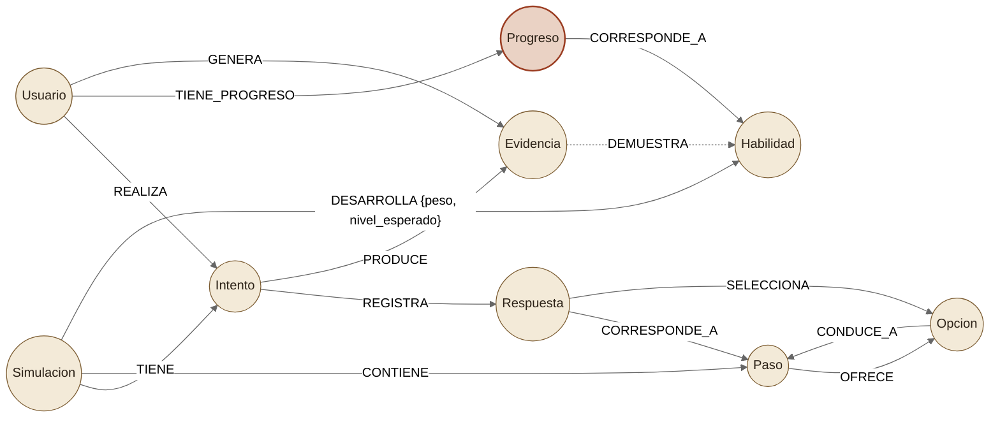

# Modelo lógico de grafo — QATO'K (v2, Neo4j)

- **Entregable:** E2, modelo de grafo (guía: «etiquetas, propiedades, tipos de relación, dirección y cardinalidades esperadas»). Issue backend #5, perfil A.
- **Estado:** PROPUESTA. Necesita la revisión de B o C.
- **Fuentes:** `docs/modelos/matriz-propiedad.md` §3 (qué se copia al grafo), `docs/KG.json` v1.2 (`physical_projection`) y la implementación probada en `database/graph/` (`npm run db:graph:probar`, informe en `docs/pruebas/`).
- **Base:** entregables A-03 a A-06 de la actividad anterior (12 etiquetas y 17 relaciones), recortados a la proyección v2 (§7).

## 1. Papel del grafo

Neo4j es una **proyección para recorridos**: responde las consultas C-01 a C-05. No es dueño de los datos que copia.

- Cada nodo copiado lleva **su id y solo las propiedades que filtran o devuelven C-01..C-05**. Los textos (descripciones, contexto de los pasos, consecuencias, comentarios) viven en MongoDB, y las cuentas, estados y transacciones en PostgreSQL.
- Neo4j es dueño únicamente de lo **derivado**: el nodo `Progreso` y la relación `DEMUESTRA`. Los dos se recalculan desde cero (`database/graph/data/04-derivados.cypher`).
- Todo lo copiado llega por un evento del outbox, que nace en PostgreSQL aunque el dato (pasos y opciones) venga del contenido de MongoDB (matriz §5). Si el grafo se pierde, se reconstruye completo (matriz §6).
- Una simulación en **BORRADOR no se proyecta**. En el grafo, `Simulacion.estado` solo toma PUBLICADA o INACTIVA.

## 2. Diagrama

**Leyenda:** nodo claro = copia de PostgreSQL o MongoDB · nodo con borde grueso = derivado (Neo4j es dueño) · flecha punteada = relación derivada · `{…}` = propiedades de la relación. La dirección de cada flecha es la del patrón en Cypher.

## 3. Etiquetas y propiedades

Origen: **PG** = copia de PostgreSQL · **MG** = copia de MongoDB · **N4** = derivado en Neo4j. Tipos de Neo4j comprobados por la prueba B7.

| Etiqueta | Propiedad | Tipo Neo4j | Obligatoria | Origen | La usa |
|---|---|---|---|---|---|
| **Usuario** | `id_usuario` | String (UUID) | Sí, única | PG `usuario` | Ancla de C-01..C-05 |
| **Simulacion** | `id_simulacion` | String (UUID) | Sí, única | PG `simulacion` | Resultado de C-01, C-03, C-04, C-05 |
| | `titulo` | String | Sí | PG | Resultado de C-01, C-04, C-05 |
| | `estado` | String: PUBLICADA, INACTIVA | Sí | PG | Filtro de C-01 |
| **Habilidad** | `id_habilidad` | String (UUID) | Sí, única | PG `habilidad` | Parámetro de C-04 y C-05; resultado de C-02; clave de `Progreso` |
| | `nombre` | String | Sí, única (RI-03) | PG | Resultado de C-01, C-02 |
| | `nivel_objetivo` | Integer 0..100 | No (sin valor no se guarda, B8) | PG | Umbral de C-02 |
| **Paso** | `id_paso` | String (UUID) | Sí, única | MG `contenidos_simulacion.pasos[]` | C-03 |
| | `orden` | Integer ≥ 1 | Sí | MG | C-03; paso inicial = 1 |
| **Opcion** | `id_opcion` | String (UUID) | Sí, única | MG `pasos[].opciones[]` | C-03 |
| **Intento** | `id_intento` | String (UUID) | Sí, única | PG `intento` | Parámetro de C-03 |
| | `estado` | String: EN_CURSO, COMPLETADO, ABANDONADO | Sí | PG | Filtro de C-05 y de `Progreso` |
| | `fecha_inicio` | DateTime | Sí | PG | Orden de C-03 |
| | `fecha_fin` | DateTime | Solo si COMPLETADO | PG | C-04, C-05, `Progreso` |
| | `puntuacion` | Float 0..100 | Solo si COMPLETADO | PG | C-05, `Progreso` |
| **Respuesta** | `id_respuesta` | String (UUID) | Sí, única | PG `respuesta` | — |
| | `secuencia` | Integer ≥ 1 | Sí, única por intento (RI-16) | PG | Orden de C-03 |
| | `tipo_retroalimentacion` | String: ACIERTO, PARCIAL, ERROR | Sí | MG (la de la opción elegida) | Conteos de C-02; C-03 |
| **Progreso** | `id_progreso` | String (UUID, `randomUUID()`) | Sí, única | N4 | — |
| | `id_usuario`, `id_habilidad` | String | Sí, únicas en pareja (RI-13) | N4 (claves de `MERGE`) | Recalcular sin duplicar |
| | `nivel_actual` | Float 0..100, 2 decimales (RI-07) | Sí | N4 (fórmula DEC-25, PROPUESTA) | C-01, C-02, C-05 |
| | `fecha_actualizacion` | DateTime | Sí | N4 (la `fecha_fin` más reciente usada) | — |
| **Evidencia** | `id_evidencia` | String (UUID) | Sí, única | PG `evidencia` | C-04 (para completar con PG) |
| | `titulo` | String | Sí | PG | Resultado de C-04 |

**No se copian:** el correo y la contraseña del usuario (RF-09), las descripciones, el contexto y los textos de pasos y opciones, `Habilidad.categoria`, `Evidencia.visibilidad`, la fecha de generación de la evidencia y todo `Comparticion`. La prueba B4 falla si un nodo trae una propiedad fuera de esta tabla.

## 4. Tipos de relación, dirección y cardinalidades

13 tipos y 14 patrones (`CORRESPONDE_A` aparece en dos; la etiqueta de origen distingue cuál es). Solo `DESARROLLA` tiene propiedades (prueba B5), copiadas de la tabla `simulacion_habilidad`. Las demás relaciones copiadas sustituyen una clave foránea de PostgreSQL o un anidamiento del contenido de MongoDB; `DEMUESTRA` es derivada.

Cardinalidad: **origen → destino** dice cuántos destinos tiene cada origen; **destino ← origen**, cuántos orígenes tiene cada destino.

| ID | Patrón | Origen → destino | Destino ← origen | Tipo | Regla | Prueba que la comprueba |
|---|---|---|---|---|---|---|
| R01 | `(Usuario)-[:REALIZA]->(Intento)` | 0..N | 1..1 | 1:N | RI-09 | C6 |
| R02 | `(Simulacion)-[:TIENE]->(Intento)` | 0..N | 1..1 | 1:N | RI-09 | C6 |
| R03 | `(Simulacion)-[:CONTIENE]->(Paso)` | 1..N | 1..1 | 1:N | RI-17 | C1 (un dueño por paso); C5 (un paso inicial por simulación, ⇒ ≥ 1) |
| R04 | `(Simulacion)-[:DESARROLLA {peso, nivel_esperado}]->(Habilidad)` | 1..N | 0..N | N:M | RI-08, RI-17 | B5 (propiedades); C17 (`0 < peso ≤ 1`, `0 ≤ nivel_esperado ≤ 100`) |
| R05 | `(Paso)-[:OFRECE]->(Opcion)` | 1..N | 1..1 | 1:N | RI-17 | C2 (un paso por opción); C3 (≥ 1 opción por paso) |
| R07 | `(Opcion)-[:CONDUCE_A]->(Paso)` | 0..1 | 0..N | N:1 | RI-11, RI-23 | C4 (a lo más un paso, dentro de la misma simulación); C12 (intento COMPLETADO termina en opción sin `CONDUCE_A`) |
| R08 | `(Intento)-[:REGISTRA]->(Respuesta)` | 0..N | 1..1 | 1:N | RI-16 | C7 (un intento por respuesta); C10 (secuencia 1..n sin huecos) |
| R09 | `(Respuesta)-[:CORRESPONDE_A]->(Paso)` | 1..1 | 0..N | N:1 | RI-10 | C7; C9 (el paso es de la simulación del intento) |
| R10 | `(Respuesta)-[:SELECCIONA]->(Opcion)` | 1..1 | 0..N | N:1 | RI-10 | C7; C8 (la opción es del paso respondido) |
| R12 | `(Usuario)-[:TIENE_PROGRESO]->(Progreso)` | 0..N | 1..1 | 1:N | RI-13 | C15; A6 (rechaza un segundo progreso del mismo par) |
| R13 | `(Progreso)-[:CORRESPONDE_A]->(Habilidad)` | 1..1 | 0..N | N:1 | RI-13 | C15; C16 (no falta ni sobra ningún progreso) |
| R14 | `(Usuario)-[:GENERA]->(Evidencia)` | 0..N | 1..1 | 1:N | RI-14 | C13 |
| R15 | `(Intento)-[:PRODUCE]->(Evidencia)` | **0..1** | 1..1 | 1:1 parcial | RI-14, RI-25 | C13 (un intento COMPLETADO del mismo autor). El máximo 1 por intento lo garantiza PostgreSQL (`evidencia.id_intento` UNIQUE) |
| R16 | `(Evidencia)-[:DEMUESTRA]->(Habilidad)` | 1..N | 0..N | N:M | RI-20 | C14 (igual al `DESARROLLA` de la simulación del intento) |

**Notas sobre las cardinalidades:**

1. **R03 y R04 tienen mínimo 1** porque en el grafo solo hay simulaciones publicadas o inactivas, que ya cumplieron RI-17 al publicarse (el contenido publicado es inmutable, D-19). En el modelo anterior el mínimo era 0 por los borradores.
2. **R04 no tiene prueba propia del mínimo 1**: lo garantiza la publicación en PostgreSQL (RI-17). La unicidad por par (RI-08) la da la clave primaria compuesta de `simulacion_habilidad`, y la carga crea la relación con `MERGE`.
3. **R15 baja de 0..N a 0..1** porque la matriz v2 hace única la columna `evidencia.id_intento` (una evidencia por intento).
4. **R16 es más estricta que RI-20:** la regla pide un subconjunto de `DESARROLLA`; la derivación crea **todas** las habilidades que desarrolla la simulación, y C14 lo comprueba en los dos sentidos.
5. **R08 no tiene máximo fijo**: depende de la longitud de la ruta (y queda abierto si se admiten ciclos, P-04).
6. Las relaciones redundantes a propósito (R09 frente a R10 + R05, y R14 frente a R01 + R15) se conservan porque dan acceso directo en C-03 y C-04. A cambio exigen RI-10 y RI-14, que comprueban C8, C9 y C13.

## 5. Restricciones e índices

Neo4j Community solo admite restricciones de unicidad. La existencia, el tipo y el rango de las propiedades los garantizan PostgreSQL (dueño) y la aplicación, y los comprueban las pruebas B7, C11, C15 y C17.

| Nombre | Tipo | Sobre | Por qué |
|---|---|---|---|
| `usuario_id`, `simulacion_id`, `habilidad_id`, `paso_id`, `opcion_id`, `intento_id`, `respuesta_id`, `progreso_id`, `evidencia_id` | Unicidad (9) | `id_*` de cada etiqueta | RI-01; la carga y la sincronización hacen `MERGE` por id |
| `habilidad_nombre` | Unicidad | `Habilidad.nombre` | RI-03 (el grafo rechaza nombres duplicados) |
| `progreso_usuario_habilidad` | Unicidad compuesta | `Progreso (id_usuario, id_habilidad)` | RI-13; recalcular con `MERGE` sin duplicar |
| `simulacion_estado` | Índice | `Simulacion.estado` | C-01: simulaciones PUBLICADAS |
| `intento_estado` | Índice | `Intento.estado` | C-05 y `Progreso`: intentos COMPLETADO |
| `paso_orden` | Índice | `Paso.orden` | C-03: orden del recorrido |
| `respuesta_secuencia` | Índice | `Respuesta.secuencia` | C-03: orden de las decisiones |

Las pruebas A1 y A2 comprueban que existen las 11 restricciones y los 4 índices; A3, que no hay restricciones de las etiquetas retiradas ni de `Usuario.correo`; A4 a A6, que las duplicadas se rechazan.

## 6. Cómo responde el grafo cada consulta

Consultas en `database/graph/queries/`, con resultados esperados en `database/graph/tests/esperados.mjs`. Los parámetros y la forma de las filas siguen el contrato F3a (`docs/api/contrato-v0.md`): las habilidades se filtran por `id_habilidad` y el recorrido es de un intento.

| Consulta | Recorrido | Qué devuelve el grafo | Qué completa el servicio |
|---|---|---|---|
| **C-01** Recomendaciones (RF-06) | `Usuario → TIENE_PROGRESO → Progreso → CORRESPONDE_A → Habilidad ← DESARROLLA ← Simulacion {PUBLICADA}` | Simulaciones con habilidades por debajo del `nivel_esperado`, ordenadas por `Σ peso · (esperado − nivel)` | Nada |
| **C-02** Fortalezas y áreas de mejora (RF-07) | `Progreso` de cada habilidad + `Intento → REGISTRA → Respuesta` de las simulaciones que la desarrollan | Clasificación contra `nivel_objetivo` (o el mayor `nivel_esperado`) y conteo de ACIERTO, PARCIAL y ERROR | Nada |
| **C-03** Recorrido de decisiones de un intento (RF-04, RF-05) | `Usuario → REALIZA → Intento` (solo el dueño) `→ REGISTRA → Respuesta → CORRESPONDE_A → Paso` y `→ SELECCIONA → Opcion` | Ids, orden, secuencia y tipo de retroalimentación | Textos del paso, la opción, las consecuencias y la retroalimentación (MongoDB, `contenidos_simulacion`) |
| **C-04** Evidencias de una habilidad (RF-08, RF-09) | `Usuario → GENERA → Evidencia → DEMUESTRA → Habilidad` y `Simulacion → TIENE → Intento → PRODUCE → Evidencia` | Evidencias con título, simulación y fecha | Visibilidad y enlaces vigentes (PostgreSQL, `evidencia` y `comparticion`) |
| **C-05** Evolución de una habilidad (RF-06) | `Usuario → REALIZA → Intento {COMPLETADO} ← TIENE ← Simulacion → DESARROLLA → Habilidad` | Puntuación y peso de cada intento en el tiempo, y el nivel consolidado | Nada |

**Datos derivados:**
- `DEMUESTRA` (RI-20): al generarse una evidencia se enlaza con las habilidades que `DESARROLLA` la simulación de su intento.
- `Progreso.nivel_actual` (**DEC-25, PROPUESTA para P-03**): promedio ponderado por `DESARROLLA.peso` de la puntuación del último intento COMPLETADO de cada simulación que desarrolla la habilidad, redondeado a 2 decimales. Con el dataset, Ana tiene Comunicación efectiva = (0.6 · 92.5 + 0.3 · 40) / 0.9 = 75. Si el equipo adopta otra fórmula, cambian `04-derivados.cypher` y la prueba C16, no este modelo.

## 7. Qué cambió respecto al modelo de la actividad anterior

El modelo conceptual común sigue siendo el del KG (12 entidades, 17 relaciones). Lo que cambia es qué parte vive en el grafo (D-16 y **D-18**, PRELIMINARES):

| Cambio | Antes (A-03..A-06) | Ahora | Por qué |
|---|---|---|---|
| Etiquetas | 12 | 9: salen `Consecuencia`, `Retroalimentacion` y `Comparticion` | No se recorren. Las dos primeras viven anidadas en el contenido (MongoDB); la compartición es transaccional (PostgreSQL) |
| Relaciones | 17 de 14 tipos | 14 patrones de 13 tipos: salen R06, R11 y R17 | Van con sus etiquetas |
| Retroalimentación | Nodo 1:1 con la respuesta | Propiedad `Respuesta.tipo_retroalimentacion` | Era su única propiedad útil (C-02) |
| Propiedades | Textos y correo en los nodos | Solo ids y lo que filtran las consultas | Una sola base dueña de cada dato; sin la restricción de `Usuario.correo` |
| Borradores | En el grafo | No se proyectan | Por eso R03 y R04 tienen mínimo 1 |
| R15 `PRODUCE` | 0..N | 0..1 | Una evidencia por intento (matriz §3) |
| Derivados | `Progreso` y `DEMUESTRA` sin dueño definido | Neo4j es su dueño y los recalcula desde cero | Matriz §3 y §5 |
| Búsqueda por texto (RF-02) | Índice de texto completo en el grafo | En PostgreSQL | Los textos ya no están en el grafo |
| C-03 y C-04 | Se resolvían solo en el grafo | El servicio las completa con MongoDB y PostgreSQL | Los textos y la compartición salen del grafo |

## 8. Coherencia con los otros dos modelos

- **Relacional (PostgreSQL, B):** cada id del grafo es la clave primaria de su tabla, y cada relación copiada es una clave foránea (`intento.id_usuario` → REALIZA, `respuesta.id_opcion` → SELECCIONA, etc.) o la tabla `simulacion_habilidad` (DESARROLLA). Ningún nodo copiado existe en el grafo sin su registro en PostgreSQL (matriz, regla 2).
- **Documental (MongoDB, C):** `id_paso`, `orden`, `id_opcion`, `id_paso_siguiente` (→ CONDUCE_A) y el `tipo` de la retroalimentación salen de `contenidos_simulacion`. Como el contenido publicado es inmutable (D-19), esta parte del grafo no cambia después de publicar.
- **Datos esperados con el dataset común:** 34 nodos y 53 relaciones (B1 y B2), sin la simulación 0303 en BORRADOR (B6).
