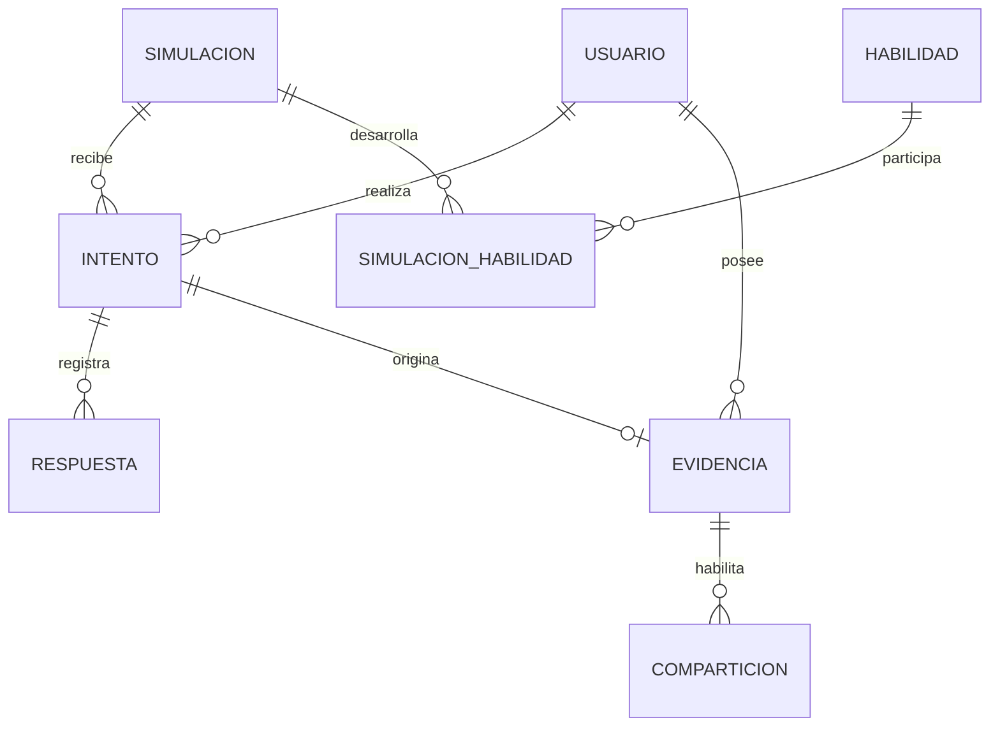

# Modelo lógico relacional de QATO’K

**Entregable E2 · Backend #13 · Diseño del paso PostgreSQL.** PostgreSQL registra las cuentas, los permisos y las operaciones que deben confirmarse juntas. MongoDB conserva el contenido que se juega y la instantánea de la evidencia. Neo4j deriva el progreso y recomienda qué practicar a partir de los intentos y su relación con las habilidades. [Matriz de propiedad](matriz-propiedad.md) · [Modelo documental](documental.md) · [Modelo de grafo](grafo.md)

## Entidades y cardinalidades

Una simulación publicada requiere al menos una habilidad y contenido válido (RI-17). El mínimo se verifica al publicar porque depende de varias filas y del documento de MongoDB. Cada intento pertenece a un usuario y una simulación. Cada evidencia pertenece al mismo usuario que realizó su intento y un intento genera como máximo una evidencia.

`evento_sincronizacion` registra cambios para Neo4j. Su `id_entidad` identifica distintos tipos de entidad según el evento. Se conserva aun si la entidad se borró, para aplicar la baja en el grafo.

## Diccionario de tablas

Los identificadores son `UUID` y los genera el backend. Las fechas son `TIMESTAMPTZ`. Las columnas son obligatorias salvo las señaladas como opcionales. Los estados y catálogos usan `VARCHAR` con `CHECK`. Los nombres y formatos siguen las [convenciones del proyecto](../../context/convenciones.md).

| Tabla | Atributos y tipos | Claves y restricciones |
|---|---|---|
| `usuario` | `id_usuario UUID`, `nombre VARCHAR(100)`, `correo VARCHAR(150)`, `contrasena_hash TEXT`, `rol`, `estado`, `fecha_registro`. | PK `id_usuario`. Correo normalizado y unicidad sobre `lower(correo)`. Roles ESTUDIANTE y ADMIN. Estados ACTIVO, INACTIVO y SUSPENDIDO. El hash queda fuera de las respuestas, del grafo y de los logs. |
| `habilidad` | `id_habilidad UUID`, `nombre VARCHAR(100)`, `descripcion TEXT`, `categoria VARCHAR(50)`, `nivel_objetivo NUMERIC(5,2)` opcional. | PK `id_habilidad`. Nombre único (RI-03). Nivel de 0 a 100 si se define. |
| `simulacion` | `id_simulacion UUID`, `titulo VARCHAR(150)`, `descripcion TEXT`, `dificultad`, `estado`, `duracion_estimada INTEGER` opcional y `id_revision_publicada UUID` opcional según estado. | PK `id_simulacion`. Dificultades BASICA, INTERMEDIA y AVANZADA. La revisión publicada es nula en BORRADOR y obligatoria en PUBLICADA e INACTIVA. Duración positiva si se define. La revisión apunta a MongoDB y la API valida esa referencia. |
| `simulacion_habilidad` | `id_simulacion UUID`, `id_habilidad UUID`, `peso NUMERIC(3,2)`, `nivel_esperado NUMERIC(5,2)`. | PK compuesta por ambos IDs, cada uno FK a su tabla. Peso mayor que 0 y hasta 1. Nivel de 0 a 100. No se exige que los pesos sumen 1. |
| `intento` | `id_intento UUID`, `id_usuario UUID`, `id_simulacion UUID`, `fecha_inicio`, `estado`, `fecha_fin` y `puntuacion NUMERIC(5,2)` opcionales según estado. | PK `id_intento`, FK a usuario y simulación. Clave única `(id_intento, id_usuario)` para la FK de evidencia. Índice único parcial propuesto sobre `(id_usuario, id_simulacion)` para EN_CURSO. |
| `respuesta` | `id_respuesta UUID`, `id_intento UUID`, `id_paso UUID`, `id_opcion UUID`, `fecha_respuesta`, `secuencia INTEGER`. | PK `id_respuesta`, FK `id_intento`. Secuencia positiva y única por intento. Los otros dos IDs apuntan al contenido de MongoDB y se validan en la API. |
| `evidencia` | `id_evidencia UUID`, `id_intento UUID`, `id_usuario UUID`, `titulo VARCHAR(150)`, `fecha_generacion`, `visibilidad`. | PK `id_evidencia`, `UNIQUE (id_intento)` y FK compuesta `(id_intento, id_usuario)` a `intento`. Visibilidad PRIVADA o PUBLICA, por defecto PRIVADA. |
| `comparticion` | `id_comparticion UUID`, `id_evidencia UUID`, `token VARCHAR(255)`, `fecha_creacion`, `estado`, `fecha_expiracion` y `destinatario VARCHAR(150)` opcionales. | PK `id_comparticion`, FK a evidencia, token único. Estados ACTIVA y REVOCADA. Si hay vencimiento, debe ser posterior a la creación (RI-21). |
| `evento_sincronizacion` | `id_evento UUID`, `orden_cola BIGINT` generado por PostgreSQL, `tipo VARCHAR(40)`, `id_entidad UUID`, `payload JSONB`, `estado VARCHAR(10)`, `intentos INTEGER`, `creado_en`, `ultimo_error TEXT`, `proximo_intento TIMESTAMPTZ` y `aplicado_en` opcionales. | PK `id_evento`, unicidad de `orden_cola`. Los 11 tipos de la matriz. Estados PENDIENTE, APLICADO y FALLIDO. Por defecto PENDIENTE y cero intentos. El servicio valida el payload según el tipo. Solo un evento PENDIENTE puede tener próxima fecha de intento. |

### Intentos y políticas de borrado

| Estado | Fecha de fin | Puntuación |
|---|---|---|
| EN_CURSO | Nula | Nula |
| COMPLETADO | Obligatoria, desde la fecha de inicio | Obligatoria, de 0 a 100 |
| ABANDONADO | Obligatoria, desde la fecha de inicio | Nula |

La tabla explica qué valores admite PostgreSQL. La fórmula de puntuación y la de progreso se revisan en P-03, D-21 y DEC-25. La condición de ABANDONADO coincide con el contrato del [evento de finalización](../../backend/src/sync/eventos.ts).

- **Cuenta:** la eliminación pasa de usuario a intentos y de estos a respuestas y evidencias. De evidencia pasa a comparticiones. La API recoge los IDs de las evidencias antes del borrado para eliminar sus instantáneas después. El evento de baja se registra en la transacción de PostgreSQL.
- **Simulación:** se elimina un BORRADOR junto con sus filas de `simulacion_habilidad`. La FK de intento restringe el borrado de una simulación con historial. La API permite desactivar la simulación publicada y conserva su contenido para consultar los intentos previos.
- **Habilidad:** la FK desde `simulacion_habilidad` impide borrarla si está en uso. La operación registra el evento de baja si corresponde.

## Dónde se garantiza cada regla

| Regla | PostgreSQL | API, MongoDB o Neo4j |
|---|---|---|
| RI-09, RI-14 y RI-25. Propiedad e historial de evidencia. | Las FK garantizan el intento y su dueño. La FK compuesta impide asociar otro usuario. La unicidad evita dos evidencias del mismo intento. | La API comprueba propiedad y estado COMPLETADO antes de crear la instantánea. MongoDB conserva una copia del recorrido y Neo4j proyecta sus habilidades. |
| RI-10, RI-16, RI-22 y RI-23. Avance y respuesta. | FK al intento, secuencia positiva y única. Una transacción registra la respuesta, el posible cierre y sus eventos. | La API bloquea la fila del intento para responder o abandonar. Comprueba estado, fechas y secuencia bajo ese bloqueo. Valida la cadena simulación → paso → opción contra MongoDB y determina si la opción termina el recorrido. |
| RI-11, RI-17, RI-18 y RI-19. Publicación y rutas. | Guarda el estado y la asociación con habilidades. El cambio a PUBLICADA y su evento se confirman juntos. | MongoDB valida la forma del documento. La API valida referencias, mínimos, paso inicial y la regla de rutas acordada. Antes de crear un intento verifica PUBLICADA dentro de la transacción y coordina esa lectura con la desactivación. |
| RI-15 y RI-21. Acceso compartido. | Token único, estado válido y orden de fechas. | La API aplica vigencia y revocación antes de leer MongoDB. Un enlace nuevo siempre recibe vencimiento. Para las dos filas del dataset sin fecha, se mantiene la semántica del KG: siguen vigentes si están activas. |
| Progreso y recomendaciones. | Conserva el resultado original y los eventos para reconstruirlo. | Neo4j calcula el progreso y usa la relación entre habilidades y simulaciones en C-01. Si está caído, la API distingue el cierre registrado del evento que sigue pendiente. |

En las lecturas de catálogo, el filtro por estado y dificultad, seguido de un orden estable que incluya `id_simulacion`, sostiene la paginación. Para las demás consultas prioritarias, el esquema debe cubrir intentos por usuario, respuestas por intento y secuencia, evidencias por dueño, enlaces por evidencia y eventos pendientes. Las claves únicas existentes se reutilizan antes de añadir índices. La selección definitiva se comprueba con las consultas del paso #12.

## Diseño de publicación y sincronización

El esquema se aprobó para el paso #12. La administración de escenarios y el consumo ordenado usan estas reglas.

### Revisión publicada

1. La edición reemplaza el borrador en MongoDB solo si coincide la versión que recibió el editor. Para publicar, la API bloquea la fila de la simulación, comprueba que sigue en BORRADOR y lee la versión solicitada por el editor. La valida y guarda una **copia inmutable** con UUID propio en una colección separada. Si no se sabe si MongoDB confirmó la inserción, se consulta ese UUID y se comprueba que corresponde a la misma simulación y contenido antes de continuar. Si no se puede confirmar, la transacción revierte.
2. Con la fila aún bloqueada, PostgreSQL registra `id_revision_publicada`, el estado PUBLICADA y el evento en una sola transacción. El evento se construye desde la misma copia inmutable. Si falla la transacción, queda una copia sin referencia para reconciliar. La limpieza debe bloquear la misma fila antes de comprobar que la copia sigue sin referencia o comprobar que la simulación ya fue eliminada.
3. El juego y la reconstrucción del grafo leen la revisión que señala PostgreSQL. Una escritura tardía en el borrador no altera una partida. En v0 una simulación conserva una única revisión publicada, incluso al pasar a INACTIVA. El dataset debe asignar un UUID fijo de revisión a cada simulación publicada. Las dos cargas usan ese mismo identificador.

### Orden de la cola

Para v0 se usa **una cola ordenada y un consumidor a la vez**, incluso cuando una solicitud pida aplicar de inmediato. Un evento fallido puede retrasar toda la proyección del grafo mientras se recupera.

- Los productores encolan al final de la transacción de negocio. Antes de asignar `orden_cola` toman un bloqueo transaccional común en PostgreSQL y lo mantienen hasta el commit o la reversión. Las escrituras de negocio ocurren antes de tomar ese bloqueo. Así, una transacción aún sin confirmar no deja una posición anterior invisible para el consumidor mientras otra publica una posición posterior. Si se revierten posiciones, los huecos son válidos.
- La aplicación inmediata y el reintento entran al mismo consumo ordenado. El procesador toma el primer evento sin aplicar, con exclusión entre consumidores, y conserva esa posición si está pendiente o requiere reparación. Si agota los reintentos, la cola se pausa en ese evento. Tras corregir la causa, el comando local de reactivación devuelve esa fila a PENDIENTE. Las transacciones de juego en PostgreSQL pueden seguir registrándose y la API informa `PENDIENTE`.
- Si Neo4j aplica un evento y falla el registro de APLICADO, se reintenta ese mismo evento antes de avanzar al siguiente. El evento de respuesta se encola antes del cierre dentro de la misma transacción. El paso #12 crea la columna y su restricción, y #7 implementa los bloqueos y el consumo.

## Revisiones relacionadas

- **Identidad y rutas:** la reconciliación verifica la cadena completa de cada respuesta. Probar borradores vacíos y escrituras simultáneas en simulaciones distintas antes de dar por válida la unicidad global de los IDs de pasos y opciones. Proponer rutas acíclicas y alcanzables para v0. La decisión P-04 se formaliza con el cambio documental.
- **Dataset:** conservar los enlaces sin vencimiento del caso histórico. La carga deja las cuentas de muestra sin contraseña utilizable salvo que se configure un hash local de pruebas. Las cuentas de muestra y sus credenciales quedan fuera del despliegue real.

La revisión de la colección de contenido y de sus índices continúa en el [modelo documental](documental.md).

## Comprobaciones para aprobar el diseño

| Caso | Resultado esperado |
|---|---|
| Evidencia vinculada al intento de otro usuario o segunda evidencia para el mismo intento. | PostgreSQL rechaza ambas operaciones. |
| Dos solicitudes abren un intento simultáneo del mismo usuario y escenario. | Solo una crea el intento. La otra puede devolver el ID del intento abierto. |
| Dos solicitudes intentan responder y abandonar a la vez. | Se aplica un orden válido. Si abandona primero, la respuesta se rechaza. Si responde con una opción terminal primero, el abandono se rechaza. |
| Opción válida de un paso distinto o paso real de otro escenario. | La API rechaza la respuesta y la reconciliación detecta el cruce en datos importados. |
| Vencimiento anterior a la creación o enlace revocado. | PostgreSQL rechaza la fecha inválida. La API deniega el acceso revocado. |
| Falla el registro del evento al guardar una respuesta terminal. | La transacción revierte la respuesta y el cierre. |
| Una edición de MongoDB termina después de publicar. | El juego y la reconstrucción leen la copia fijada en PostgreSQL. |
| Respuesta y cierre comparten fecha y la respuesta agota reintentos. | La cola conserva su orden. El cierre espera a que la reconciliación repare la respuesta. |
| Neo4j falla después de confirmar el cierre. | La respuesta y el cierre permanecen en PostgreSQL. El reintento registra la respuesta en el grafo antes del cierre y el perfil refleja el resultado cuando se aplica. |
